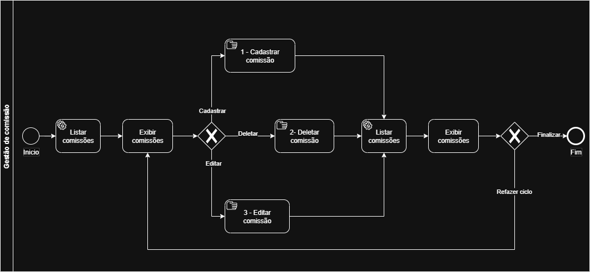

### 3.3.1 Processo 1 – GESTÃO DE COMISSÃO

O **processo de Gestão de Comissão** tem como objetivo permitir que o usuário visualize, cadastre, edite e exclua comissões dentro do sistema. Inicialmente, o sistema apresenta a listagem das comissões existentes, permitindo ao usuário visualizar os registros disponíveis. A partir dessa visualização, o usuário pode decidir realizar uma das ações disponíveis: cadastrar uma nova comissão, editar uma comissão existente ou excluir uma comissão.

Após a execução de qualquer uma dessas ações, o sistema retorna à listagem atualizada de comissões. O usuário pode repetir o ciclo de gerenciamento quantas vezes desejar até decidir finalizar o processo(ir para outra tela ou sair do software).

#### Oportunidades de melhoria

Algumas oportunidades de melhoria identificadas no processo são:

- Implementação de **validações automáticas** para evitar cadastro de comissões duplicadas.
- Inclusão de **confirmação antes da exclusão** de uma comissão.
- Possibilidade de **filtros e busca na listagem de comissões** para facilitar a navegação.
- Registro de **histórico de alterações** para auditoria.
- Feedback visual ao usuário após operações de cadastro, edição ou exclusão.

Em seguida, apresenta-se o modelo do processo utilizando o padrão BPMN.

---

## Detalhamento das atividades

### Listar comissões

| **Campo** | **Tipo** | **Restrições** | **Valor default** |
| --- | --- | --- | --- |
| filtroNome | Caixa de texto | opcional | |
| statusComissao | Seleção única | Ativa / Inativa | Ativa |

| **Comandos** | **Destino** | **Tipo** |
| --- | --- | --- |
| visualizar | Exibir comissões | default |

---

### Exibir comissões

| **Campo** | **Tipo** | **Restrições** | **Valor default** |
| --- | --- | --- | --- |
| listaComissoes | Tabela | exibe todas as comissões cadastradas | |

| **Comandos** | **Destino** | **Tipo** |
| --- | --- | --- |
| cadastrar comissão | 1 - Cadastrar comissão | default |
| editar comissão | 3 - Editar comissão | |
| deletar comissão | 2 - Deletar comissão | |
| finalizar | Fim do Processo 1 | cancel |

---

### 1 - Cadastrar comissão

| **Campo** | **Tipo** | **Restrições** | **Valor default** |
| --- | --- | --- | --- |
| nomeComissao | Caixa de texto | obrigatório | |
| descricao | Área de texto | opcional | |
| percentual | Número | mínimo 0 máximo 100 | |
| dataCriacao | Data | preenchido automaticamente | data atual |

| **Comandos** | **Destino** | **Tipo** |
| --- | --- | --- |
| salvar | Listar comissões | default |
| cancelar | Exibir comissões | cancel |

---

### 2 - Deletar comissão

| **Campo** | **Tipo** | **Restrições** | **Valor default** |
| --- | --- | --- | --- |
| idComissao | Número | obrigatório | |
| confirmacao | Seleção única | Sim / Não | Não |

| **Comandos** | **Destino** | **Tipo** |
| --- | --- | --- |
| confirmar exclusão | Listar comissões | default |
| cancelar | Exibir comissões | cancel |

---

### 3 - Editar comissão

| **Campo** | **Tipo** | **Restrições** | **Valor default** |
| --- | --- | --- | --- |
| idComissao | Número | obrigatório | |
| nomeComissao | Caixa de texto | obrigatório | valor atual |
| descricao | Área de texto | opcional | valor atual |
| percentual | Número | mínimo 0 máximo 100 | valor atual |

| **Comandos** | **Destino** | **Tipo** |
| --- | --- | --- |
| salvar alterações | Listar comissões | default |
| cancelar | Exibir comissões | cancel |
