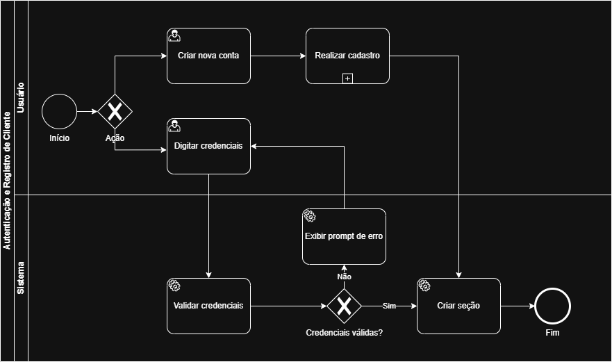
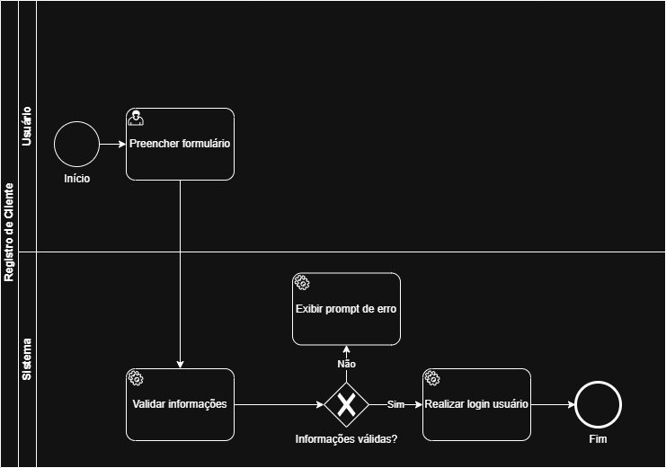
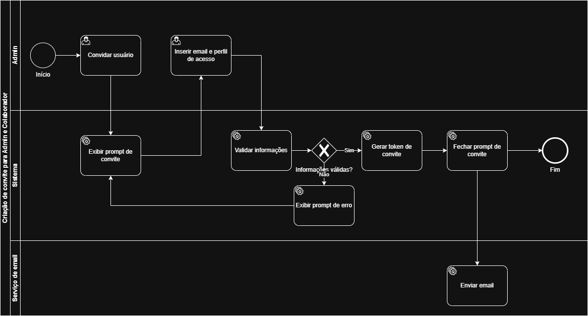
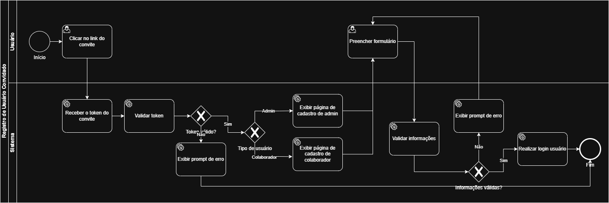
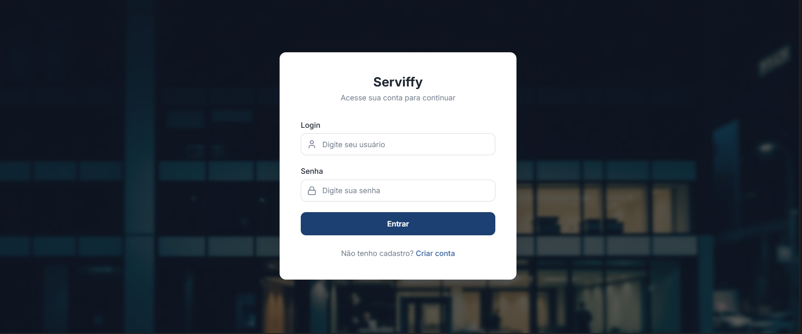
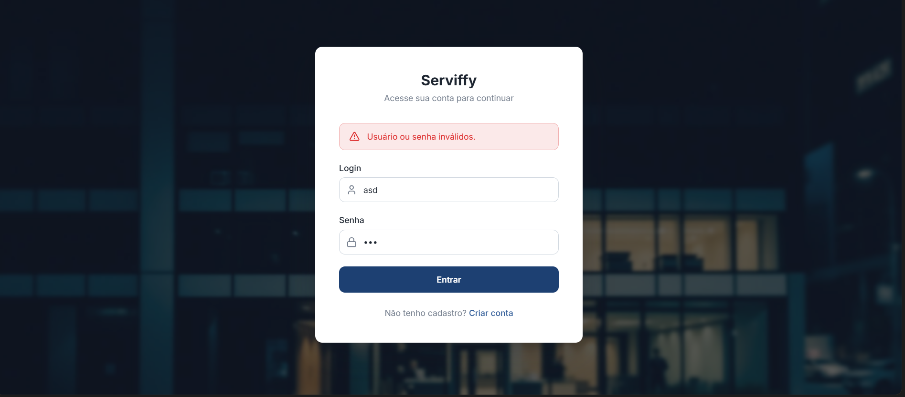
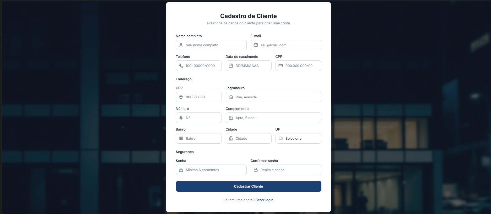
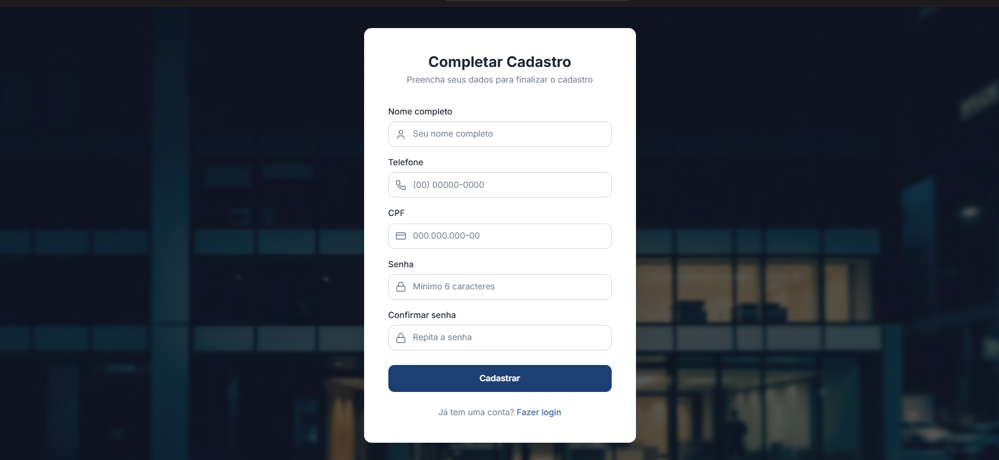
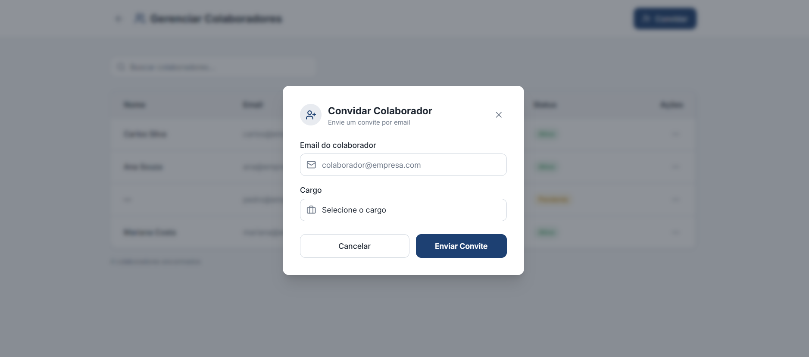
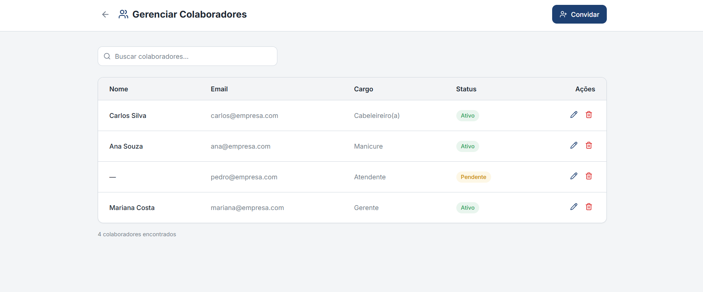

# 3.3.1 Processo 1 – GESTÃO DE USUÁRIO

---

O processo de **Gestão de Usuário** tem como objetivo permitir o cadastro e manutenção das informações dos colaboradores e clientes da empresa, garantindo maior organização dos dados, rastreabilidade e apoio aos demais processos do sistema, como agendamento, prestação de serviços e cálculo de comissão.

Atualmente, em muitos pequenos negócios, o controle de colaboradores é feito de maneira informal ou por meio de planilhas, o que pode gerar inconsistências cadastrais, retrabalho e dificuldade de integração com outros processos da operação. Com a informatização desse processo, será possível centralizar as informações dos profissionais, melhorar a confiabilidade dos dados e aumentar a eficiência administrativa do negócio.

---

## Oportunidades de melhoria

---

A informatização do processo de Gestão de Colaborador traz as seguintes oportunidades de melhoria:

• centralização das informações cadastrais em um único sistema;

• redução de erros decorrentes de controles manuais;

• facilidade para localizar e atualizar dados dos profissionais;

• integração com processos de agendamento, serviços e comissão;

• maior segurança no acesso às informações;

• melhor rastreabilidade das alterações realizadas no cadastro.

---

## Modelagem

---

Em seguida, apresenta-se os modelos do processo de Gestão de Colaborador, descritos no padrão BPMN:

### Autenticação e Registro de Cliente

### Subprocesso - Registro de Cliente

### Criação de Convite para Admin e Colaborador

### Registro de Usuário Convidado

---

## Detalhamento das atividades

---

## Subprocesso 1 – Autenticação e Registro de Cliente

O processo de **Autenticação e Registro de Cliente** tem como objetivo permitir que um cliente acesse o sistema por meio do cadastro de uma nova conta ou pela autenticação com credenciais já existentes. O processo garante que apenas usuários com credenciais válidas obtenham acesso ao sistema. O processo se inicia com o usuário acessando a aplicação Web e apresentando a ele as opções disponíveis: criar uma nova conta ou digitar credenciais de acesso já existentes. Caso o usuário acione a opção de criação de uma nova conta, o sistema redireciona para o subprocesso de cadastro responsável pelo preenchimento e validação dos dados cadastrais do novo cliente. Ao ser concluído com sucesso, o sistema redireciona o usuário para a tela de autenticação. O detalhamento interno deste subprocesso está descrito no **Processo 2 – Registro de Cliente**. O usuário insere suas credenciais de acesso ao sistema (e-mail e senha). Esta atividade é inicializada tanto pelo fluxo de login direto quanto após a conclusão do cadastro. Depois há uma atividade executada pelo sistema em que as credenciais informadas são verificadas em relação à existência do usuário e à correspondência da senha. Não há interação direta do usuário nesta etapa. Caso a validação invalide a entrada, o sistema exibe uma mensagem de erro informando que as credenciais inseridas são inválidas. Então o usuário é redirecionado para tentar novamente. Caso a validação das credenciais seja bem-sucedida, uma sessão autenticada é criada para o usuário, concedendo a ele acesso ao sistema.

## Subprocesso 2 – Registro de Cliente

O processo de **Registro de Cliente** corresponde ao subprocesso de cadastro referenciado no Processo 1. Ele tem como objetivo coletar e validar as informações do novo cliente, efetuando seu login automaticamente ao final do cadastro bem-sucedido. O usuário preenche o formulário de cadastro com seus dados pessoais de acesso (esta é a única atividade de interação do usuário neste processo). Em seguida, há uma atividade executada pelo sistema em que os dados informados no formulário são verificados em relação ao cumprimento das restrições definidas (campos obrigatórios, e-mail único, correspondência de senha). Depois o sistema exibe uma mensagem de erro indicando quais campos precisam ser corrigidos. O usuário retorna ao formulário para efetuar os ajustes necessários. Após a validação bem-sucedida dos dados, o novo cadastro é registrado e uma sessão autenticada é criada automaticamente para o usuário encerrando o subprocesso.

## Subprocesso 3 – Criação de Convite para Admin e Colaborador

O processo de **Criação de Convite para Admin e Colaborador** tem como objetivo permitir que um administrador convide novos usuários para o sistema definindo seu e-mail e perfil de acesso. O sistema valida as informações, gera um token de convite e envia o convite por e-mail ao destinatário. O processo se inicia com o administrador acionando a funcionalidade de convite de novo usuário. Em seguida, o sistema exibe o prompt de convite para preenchimento das informações e exibe o formulário de convite para que o administrador insira o e-mail e o perfil de acesso do usuário convidado. O administrador preenche o e-mail do destinatário e define o perfil de acesso que será atribuído ao usuário convidado. Depois disso, há uma atividade do sistema em que e-mail e o perfil de acesso informados são verificados quanto ao formato e preenchimento obrigatório. Caso encontre algum erro, o sistema exibe uma mensagem de erro informando quais campos estão incorretos. Seguido disso, o administrador retorna ao formulário para corrigir os dados. Uma vez corrigido os dados ou inseridos eles corretamente, um token único de convite é gerado e associado ao e-mail e perfil de acesso definidos pelo administrador. Este token será utilizado para autenticar o convite no momento do registro do usuário. Em seguida, o sistema fecha o formulário de convite e aciona o serviço de e-mail para envio do convite ao destinatário. Ao final, o convite contendo o link com o token gerado é enviado ao endereço de e-mail informado pelo administrador.

## Subprocesso 4 – Registro de Usuário Convidado

O processo de **Registro de Usuário Convidado** tem como objetivo permitir que um usuário que recebeu um convite por e-mail conclua seu cadastro no sistema. O processo valida o token do convite, identifica o tipo de usuário (Admin ou Colaborador), exibe o formulário de cadastro correspondente e, após validação dos dados, realiza o login automaticamente. O processo se inicia com o usuário acessando o link de convite recebido por e-mail. Em seguida, o sistema recebe o token embutido no link e inicia o processo de validação. Há uma atividade executada pelo sistema em que o token presente no link é recebido e encaminhado para validação. Depois disso, o token recebido é verificado quanto à sua existência, validade e prazo de expiração. De acordo com a falta de correspondência, o sistema exibe uma mensagem informando que o link do convite é inválido ou expirou e então o processo é encerrado. Se a correspondência é positiva e o sistema identifica o perfil de acesso associado ao token do convite, ele redireciona para a página de cadastro correspondente. Logo em seguida, o sistema exibe o formulário de cadastro para o perfil de administrador ou o formulário de cadastro para o perfil de colaborador a depender do acesso. Então o usuário preenche o formulário de cadastro exibido conforme seu perfil de acesso. Esta atividade é compartilhada pelos fluxos de admin e colaborador. Depois há uma atividade do sistema em que os dados preenchidos no formulário são verificados quanto ao cumprimento das restrições definidas. Em caso de negativa, o sistema exibe uma mensagem de erro indicando quais campos precisam ser corrigidos e o usuário retorna ao formulário para efetuar os ajustes. Em caso de validação bem-sucedida dos dados, o novo cadastro é efetuado, o token de convite é invalidado e uma sessão autenticada é criada automaticamente para o usuário.

## Subprocessos

---

## Subprocesso 1 – Autenticação e Registro do Usuário

---

#### Abrir aplicação

| **Campo** | **Tipo**       | **Restrições** | **Valor padrão** |
| --------- | -------------- | -------------- | ---------------- |
| Login    | Caixa de texto | obrigatório    | vazio            |
| Senha     | Caixa de texto | obrigatório    | vazio            |

| **Comandos** | **Destino**                        | **Tipo** |
| ------------ | ---------------------------------- | -------- |
| Entrar       | Atividade "Acessar meus agendamentos"    | padrão   |
| Criar conta    | Atividade "Criar conta"       | padrão   |

| **Resultado**       | **Destino**     |
| ------------------- | --------------- |
| Sessão criada (cliente)      | Atividade "Acessar meus agendamentos - Cliente" |
| Sessão criada (colaborador)      | Atividade "Acessar meus agendamentos - Colaborador" |
| Sessão criada (admi)      | Atividade "Registro de Usuário Convidado" |
| Mensagem de erro    | "Credenciais inválidas. Tente novamente." |

---

## Subprocesso 2 – Registro de Cliente

---

#### Preencher formulário

| **Campo**          | **Tipo**       | **Restrições**       | **Valor padrão** |
| ------------------ | -------------- | -------------------- | ---------------- |
| Nome completo      | Caixa de texto | obrigatório          | vazio            |
| E-mail             | Caixa de texto | obrigatório e único; deve ter formato válido  | vazio            |
| Telefone           | Caixa de texto | obrigatório; deve ter formato válido          | vazio            |
| Data de nascimento | Data           | obrigatório; deve ter formato válido         | vazio            |
| CPF                | Caixa de texto | obrigatório e único  | vazio            |
| CEP                | Caixa de texto | obrigatório; deve ter formato válido         | vazio            |
| Logradouro         | Caixa de texto | obrigatório          | vazio            |
| Número             | Caixa de texto | obrigatório          | vazio            |
| Complemento        | Caixa de texto | obrigatório          | vazio            |
| Bairro             | Caixa de texto | obrigatório          | vazio            |
| Cidade             | Caixa de texto | obrigatório          | vazio            |
| UF                 | Seleção única  | obrigatório          | vazio            |
| Senha              | Caixa de texto | obrigatório          | vazio            |
| Confirmar senha    | Caixa de texto | obrigatório; deve ser igual ao campo senha | vazio |

| **Comandos**  | **Destino**                       | **Tipo** |
| ------------- | --------------------------------- | -------- |
| Cadastrar     | Atividade "Abrir aplicação"   | padrão   |
| Fazer login   | Atividade "Abrir aplicação"     | padrão |

| **Resultado**        | **Destino**                          |
| -------------------- | ------------------------------------ |
| Cadastro realizado  | Toast "Cadastro realizado com sucesso." e Atividade "Preencher formulário"  |
| Mensagem de erro    | "Campo inválido" |

---

## Subprocesso 3 – Registro de Usuários

---

#### Clicar no link do convite

| **Campo**        | **Tipo** | **Restrições**  | **Valor padrão**               |
| ---------------- | -------- | --------------- | ------------------------------ |
| link do convite  | Exibição | somente leitura | recebido por e-mail            |

| **Comandos**          | **Destino**                         | **Tipo** |
| --------------------- | ----------------------------------- | -------- |
| clicar no link        | Atividade "Receber o token do convite" | padrão |

---

#### Receber o token do convite

| **Campo**       | **Tipo** | **Restrições**  | **Valor padrão**               |
| --------------- | -------- | --------------- | ------------------------------ |
| token do convite | Interno | somente leitura | extraído do link acessado      |

| **Resultado**   | **Destino**                  |
| --------------- | ---------------------------- |
| token recebido  | Atividade "Validar token"    |

---

#### Validar token

| **Campo**        | **Tipo** | **Restrições**                             | **Valor padrão** |
| ---------------- | -------- | ------------------------------------------ | ---------------- |
| token do convite | Interno  | deve existir no sistema e estar dentro do prazo de validade | — |

| **Resultado**   | **Destino**                               |
| --------------- | ----------------------------------------- |
| token válido    | Gateway "Tipo de usuário"                 |
| token inválido  | Atividade "Exibir prompt de erro" (token) |

---

#### Exibir prompt de erro (token inválido)

| **Campo**        | **Tipo** | **Restrições**  | **Valor padrão**                              |
| ---------------- | -------- | --------------- | --------------------------------------------- |
| mensagem de erro | Exibição | somente leitura | "Link de convite inválido ou expirado."       |

| **Resultado**  | **Destino**     |
| -------------- | --------------- |
| erro exibido   | Fim do processo |

---

#### Tipo de usuário (Gateway de decisão)

| **Resultado**  | **Destino**                                     |
| -------------- | ----------------------------------------------- |
| Admin          | Atividade "Exibir página de cadastro de admin"  |
| Colaborador    | Atividade "Exibir página de cadastro de colaborador" |

---

#### Exibir página de cadastro de admin

| **Campo**          | **Tipo** | **Restrições**  | **Valor padrão**        |
| ------------------ | -------- | --------------- | ----------------------- |
| formulário de admin | Exibição | somente leitura | exibido pelo sistema    |

| **Comandos**    | **Destino**                        | **Tipo** |
| --------------- | ---------------------------------- | -------- |
| preencher       | Atividade "Preencher formulário"   | padrão   |
| cancelar        | Fim do processo                    | cancelar |

---

#### Exibir página de cadastro de colaborador

| **Campo**                | **Tipo** | **Restrições**  | **Valor padrão**        |
| ------------------------ | -------- | --------------- | ----------------------- |
| formulário de colaborador | Exibição | somente leitura | exibido pelo sistema    |

| **Comandos**    | **Destino**                        | **Tipo** |
| --------------- | ---------------------------------- | -------- |
| preencher       | Atividade "Preencher formulário"   | padrão   |
| cancelar        | Fim do processo                    | cancelar |

---

#### Preencher formulário

| **Campo**       | **Tipo**       | **Restrições**                              | **Valor padrão** |
| --------------- | -------------- | ------------------------------------------- | ---------------- |
| nome completo   | Caixa de texto | obrigatório                                 | vazio            |
| e-mail          | Caixa de texto | obrigatório; preenchido automaticamente com o e-mail do convite | e-mail do convite |
| senha           | Caixa de texto | obrigatório                                 | vazio            |
| confirmar senha | Caixa de texto | obrigatório; deve ser igual ao campo senha  | vazio            |

| **Comandos**  | **Destino**                       | **Tipo** |
| ------------- | --------------------------------- | -------- |
| cadastrar     | Atividade "Validar informações"   | padrão   |
| cancelar      | Fim do processo                   | cancelar |

---

#### Validar informações

| **Campo**       | **Tipo** | **Restrições**                              | **Valor padrão** |
| --------------- | -------- | ------------------------------------------- | ---------------- |
| nome completo   | Interno  | não pode ser vazio                          | —                |
| e-mail          | Interno  | não pode ser vazio; deve ter formato válido | —                |
| senha           | Interno  | não pode ser vazia                          | —                |
| confirmar senha | Interno  | deve ser igual ao campo senha               | —                |

| **Resultado**         | **Destino**                          |
| --------------------- | ------------------------------------ |
| informações válidas   | Atividade "Realizar login usuário"   |
| informações inválidas | Atividade "Exibir prompt de erro" (formulário) |

---

#### Exibir prompt de erro (formulário inválido)

| **Campo**        | **Tipo** | **Restrições**  | **Valor padrão**                       |
| ---------------- | -------- | --------------- | -------------------------------------- |
| mensagem de erro | Exibição | somente leitura | descrição do(s) campo(s) com problema  |

| **Comandos** | **Destino**                        | **Tipo** |
| ------------ | ---------------------------------- | -------- |
| corrigir     | Atividade "Preencher formulário"   | padrão   |

---

#### Realizar login usuário

| **Campo**          | **Tipo** | **Restrições**  | **Valor padrão**                    |
| ------------------ | -------- | --------------- | ----------------------------------- |
| dados do cadastro  | Interno  | somente leitura | dados validados na etapa anterior   |
| token do convite   | Interno  | invalidado após uso | —                               |

| **Resultado**    | **Destino**     |
| ---------------- | --------------- |
| login realizado  | Fim do processo |

---

## Subprocesso 4 – Criação de Convite para Admin e Colaborador

---

#### Convidar usuário

| **Comandos**     | **Destino**                         | **Tipo** |
| ---------------- | ----------------------------------- | -------- |
| Convidar | Atividade "Exibir prompt de convite" | padrão  |

---

#### Exibir prompt de convite

| **Campo**         | **Tipo**       | **Restrições**                        | **Valor padrão** |
| ----------------- | -------------- | ------------------------------------- | ---------------- |
| E-mail do usuário            | Caixa de texto | obrigatório; deve ter formato válido  | vazio            |
| Cargo  | Seleção única  | Admin / Colaborador                   | Colaborador      |

| **Comandos**          | **Destino**                              | **Tipo** |
| --------------------- | ---------------------------------------- | -------- |
| Enviar Convite | Atividade "Exibir mensagem de convite enviado" | padrão |
| Cancelar              | Fim do processo                          | cancelar |

| **Resultado**        | **Destino**                          |
| -------------------- | ------------------------------------ |
| Convite enviado  | Atividade "Convite convite enviado com sucesso"   |
| Mensagem | "Não foi possível enviar o convite. Tente novamente."   |

---

#### Fechar prompt de convite

| **Comandos**          | **Destino**                              | **Tipo** |
| --------------------- | ---------------------------------------- | -------- |
| "X" | Atividade "Exibir mensagem de convite enviado" | padrão |

| **Campo**          | **Tipo** | **Restrições**  | **Valor padrão**              |
| ------------------ | -------- | --------------- | ----------------------------- |
| prompt de convite  | Exibição | somente leitura | fechado automaticamente       |

| **Resultado**     | **Destino**               |
| ----------------- | ------------------------- |
| prompt fechado    | Atividade "Enviar e-mail" |

---

#### Enviar e-mail

| **Campo**           | **Tipo** | **Restrições**  | **Valor padrão**                        |
| ------------------- | -------- | --------------- | --------------------------------------- |
| destinatário        | Interno  | somente leitura | e-mail informado pelo administrador     |
| link do convite     | Interno  | somente leitura | gerado com o token de convite           |

| **Resultado**    | **Destino**     |
| ---------------- | --------------- |
| e-mail enviado   | Fim do processo |

---
 
## Wireframe

### Autenticação e Registro de Cliente

### Subprocesso - Registro de Cliente

### Criação de Convite para Admin e Colaborador

### Registro de Colaboradores e Cliente

