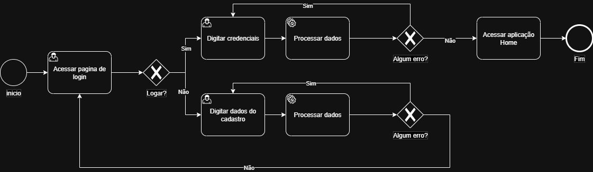
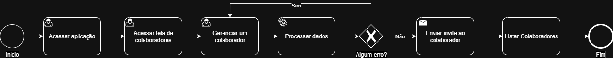
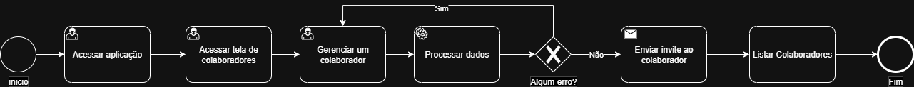
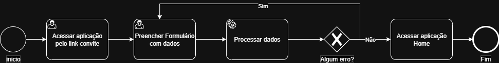
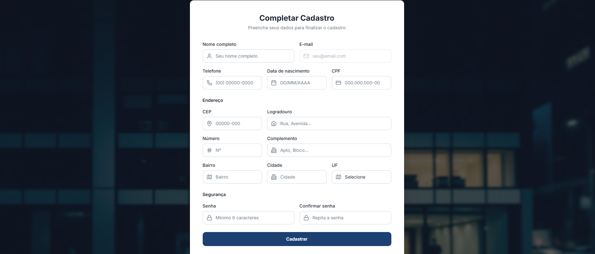
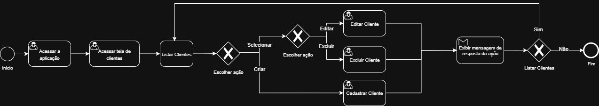

# 3.3.1 Processo 1 – GESTÃO DE USUÁRIO

O processo de **Gestão de Usuário** tem como objetivo permitir o cadastro e manutenção das informações dos colaboradores e clientes da empresa, garantindo maior organização dos dados, rastreabilidade e apoio aos demais processos do sistema, como agendamento, prestação de serviços e cálculo de comissão.

Atualmente, em muitos pequenos negócios, o controle de colaboradores é feito de maneira informal ou por meio de planilhas, o que pode gerar inconsistências cadastrais, retrabalho e dificuldade de integração com outros processos da operação. Com a informatização desse processo, será possível centralizar as informações dos profissionais, melhorar a confiabilidade dos dados e aumentar a eficiência administrativa do negócio.

## Oportunidades de melhoria

A informatização do processo de Gestão de Usuário traz as seguintes oportunidades de melhoria:

• centralização das informações cadastrais em um único sistema;

• redução de erros decorrentes de controles manuais;

• facilidade para localizar e atualizar dados dos profissionais;

• integração com processos de agendamento, serviços e comissão;

• maior segurança no acesso às informações;

• melhor rastreabilidade das alterações realizadas no cadastro.

## Modelagem

Em seguida, apresentam-se os modelos dos sub-processos do processo de Gestão de Usuário, descritos no padrão BPMN:

## Subprocesso 1 – Autenticação de Cliente

O subprocesso de **Autenticação de Cliente** tem como objetivo permitir que um cliente acesse o sistema por meio do cadastro de uma nova conta ou pela autenticação com credenciais já existentes. O subprocesso garante que apenas usuários com credenciais válidas obtenham acesso ao sistema. O subprocesso se inicia com o cliente acessando a aplicação Web e apresentando a ele as opções disponíveis: o botão de "Criar conta" para criar uma nova conta ou digitar credenciais de acesso já existentes nos campos de "Login" e "Senha". Caso o usuário acione a opção de criação de uma nova conta, o sistema redireciona para o subprocesso **Registro de Cliente** de cadastro responsável pelo preenchimento e validação dos dados cadastrais do novo cliente. O detalhamento interno deste subprocesso está descrito em **Subprocesso 2 – Registro de Cliente**. Já na opção de digitar credenciais, o usuário insere suas credenciais de acesso ao sistema (e-mail e senha) e clica no botão de "Entrar". Esta atividade é inicializada tanto pelo fluxo de login direto quanto após a conclusão do cadastro em Registro de Cliente. Caso haja algum problema com as credenciais de modo que elas sejam inválidas, o usuário recebe um prompt de erro informando que as credenciais inseridas são inválidas. Então o usuário é redirecionado para tentar novamente. Caso a validação das credenciais seja bem-sucedida, uma sessão autenticada é criada para o usuário, concedendo a ele acesso ao sistema.

### Detalhamento das atividades

#### Acessar a aplicação

| **Campo** | **Tipo**       | **Restrições** | **Valor padrão** |
| --------- | -------------- | -------------- | ---------------- |
| Login    | Caixa de texto | obrigatório    | vazio            |
| Senha     | Caixa de texto | obrigatório    | vazio            |

| **Comandos** | **Destino**                        | **Tipo** |
| ------------ | ---------------------------------- | -------- |
| Entrar       | Atividade "Acessar meus agendamentos"    | padrão   |
| Criar conta    | Atividade "Criar conta"       | padrão   |

| **Resultado**       | **Destino**     |
| ------------------- | --------------- |
| Sessão criada (cliente)     | Atividade "Acessar meus agendamentos - Cliente" |
| Prompt de erro    | "Usuário ou senha inválidos." |

### Wireframes

---

---

## Subprocesso 2 – Registro de Cliente

O subprocesso de **Registro de Cliente** corresponde ao subprocesso de cadastro referenciado no Subprocesso 1. Ele tem como objetivo coletar, validar e registrar as informações de um novo cliente, criando uma credencial de acesso a ele ao final do cadastro bem-sucedido. O subprocesso se inicia com o cliente acessando o formulário de cadastro e apresentando a ele as opções disponíveis: o botão de "Fazer login" para retornar a tela de acesso do Subprocesso 1 ou preencher seus dados pessoais de acesso (nome completo, e-mail, telefone, data de nascimento, CPF, CEP, logradouro, número, complemento, bairro, cidade, UF, senha e confirmação de senha). Após isso, o cliente pressioa o botão de "Cadastrar Cliente" para enviar o seu formulário de cadastro do sistema. Caso haja algum erro com alguma informação sendo inválida, o usuário recebe um prompt de erro indicando quais campos precisam ser corrigidos. O usuário retorna ao formulário para efetuar os ajustes necessários. Caso o usuário clique em cadastrar e a validação seja bem-sucedida, o cliente é redirecionado para a tela de login retornando ao **Subprocesso 1 – Autenticação de Cliente** e recebe uma mensagem de "Cadastro realizado com sucesso" no topo superior direito da tela.

### Detalhamento das atividades

#### Preencher formulário

| **Campo**          | **Tipo**       | **Restrições**       | **Valor padrão** |
| ------------------ | -------------- | -------------------- | ---------------- |
| Nome completo      | Caixa de texto | obrigatório          | vazio            |
| E-mail             | Caixa de texto | obrigatório e único; deve ter formato válido  | vazio            |
| Telefone           | Caixa de texto | obrigatório; deve ter formato válido          | vazio            |
| Data de nascimento | Data           | obrigatório; deve ter formato válido         | vazio            |
| CPF                | Caixa de texto | obrigatório e único  | vazio            |
| CEP                | Caixa de texto | obrigatório; deve ter formato válido         | vazio            |
| Logradouro         | Caixa de texto | obrigatório          | vazio            |
| Número             | Caixa de texto | obrigatório          | vazio            |
| Complemento        | Caixa de texto | obrigatório          | vazio            |
| Bairro             | Caixa de texto | obrigatório          | vazio            |
| Cidade             | Caixa de texto | obrigatório          | vazio            |
| UF                 | Seleção única  | obrigatório          | vazio            |
| Senha              | Caixa de texto | obrigatório          | vazio            |
| Confirmar senha    | Caixa de texto | obrigatório; deve ser igual ao campo senha | vazio |

| **Comandos**  | **Destino**                       | **Tipo** |
| ------------- | --------------------------------- | -------- |
| Cadastrar Cliente     | Atividade "Acessar a aplicação"   | padrão   |
| Fazer login   | Atividade "Acessar a aplicação"     | padrão |

| **Resultado**        | **Destino**                          |
| -------------------- | ------------------------------------ |
| Cadastro realizado  | Toast "Cadastro realizado com sucesso." e Atividade "Acessar a aplicação"  |
| Prompt de erro    | "Campo inválido." |

### Wireframes

---

## Subprocesso 3 – Gerenciamento de Colaboradores

O subprocesso de **Gerenciamento de Colaboradores** tem como objetivo permitir que um administrador gerencie perfis de colaboradores e admins existentes e convide novos usuários para o sistema. O ato de gerenciamento permite que o administrador exclua um perfil, adicione um perfil ou realize a edição de alguma de suas informações. O subprocesso se inicia com o administrador acessando a página de Gerenciamento de Colaboradores e Admins e exibindo a ele a listagem de usuários cadastrados no sistema e as seguintes opções: buscar um usuário, convidar um usuário, editar um usuário ou excluir um usuário. 
- Caso o admin queira buscar um usuário, ele digita na barra de pesquisa o nome do colaborador de modo que o sistema retorna a listagem filtrada pelo resultado de pesquisa. O usuário pode apagar a digitação de modo a retornar para a listagem total padrão.
- Caso o admin queira convidar um usuário, ele pressiona o botão de "Convidar" e depois com o modal aberto, ele pode digitar o e-mail do colaborador, o cargo, o nível de acesso e clicar em "Enviar convite". Caso o e-mail seja válido e já não esteja cadastrado, o modal altera para uma mensagem de 'Convite enviado com sucesso' para o administrador. Caso o e-mail seja inválido, uma mensagem de "E-mail inválido." aparece para o admin e ele pode tentar digitar novamente para enviar o convite. O administrador, ainda pode no modal, clicar no "X" para fechar o modal ou "Cancelar" para cancelar a operação e fechar o modal.
- Caso o admin queira editar um usuário, ele pode clicar no ícone de lápis e adaptar a informação atual do sistema daquele usuário referente a e-mail, cargo, nível de acesso ou status e depois clicar em "Salvar". Caso tenha sucesso, uma mensagem de sucesso aparece no canto superior direito para o admin. O administrador, ainda pode no modal, clicar no "X" para fechar o modal ou "Cancelar" para cancelar a operação e fechar o modal.
- Caso o admin queira excluir um usuário, ele pode clicar no ícone da lixeira e depois com o modal aberto, pressionar o botão "Excluir" para confirmar a exclusão daquele usuário e seu acesso do sistema. O administrador, ainda pode no modal, clicar no "X" para fechar o modal ou "Cancelar" para cancelar a operação e fechar o modal.

### Detalhamento das atividades

#### Acessar a página de gerenciamento de colaboradores e admins

| **Campo**         | **Tipo**       | **Restrições**                        | **Valor padrão** |
| ----------------- | -------------- | ------------------------------------- | ---------------- |
| Buscar colaboradores           | Caixa de texto | vazio  | vazio            |

| **Comandos** | **Destino**                                   | **Tipo** |
| ---          | ---                                           | -------- |
| Convidar     | Atividade "Convidar novo usuário"          | padrão   |
| Editar (lápis)       | Atividade "Editar perfil"   | padrão   |
| Excluir (lixeira)      | Atividade "Excluir perfil" | padrão   |

| **Resultado**       | **Destino**     |
| ------------------- | --------------- |
| Colaborador encontrado     | Colaborador filtrado. |
| Modal convite     | Atividade "Convidar novo usuário" |
| Modal edição     | Atividade "Editar perfil" |
| Modal exclusão    | Atividade "Excluir perfil" |

---

#### Convidar novo usuário

| **Campo**         | **Tipo**       | **Restrições**                        | **Valor padrão** |
| ----------------- | -------------- | ------------------------------------- | ---------------- |
| E-mail do colaborador           | Caixa de texto | obrigatório; deve ter formato válido  | vazio            |
| Cargo  | Seleção única  | Cabeleireiro/Manicure/Atendente/Gerente                   | vazio      |
| Nível de acesso  | Seleção única  | Admin/Colaborador                   | vazio      |

| **Comandos**          | **Destino**                              | **Tipo** |
| --------------------- | ---------------------------------------- | -------- |
| Enviar Convite | Atividade "Exibir prompt de convite" | padrão |
| Cancelar              | Atividade "Acessar a página de gerenciamento de colaboradores e admins"     | cancelar |

| **Resultado**        | **Destino**                          |
| -------------------- | ------------------------------------ |
| Convite enviado  | Atividade "Exibir prompt de convite"   |
| Mensagem | "Não foi possível enviar o convite. Tente novamente."   |
| Operação cancelada  | Atividade "Acessar a página de gerenciamento de colaboradores e admins"   |

---

#### Exibir prompt de convite

| **Campo**          | **Tipo** | **Restrições**  | **Valor padrão**              |
| ------------------ | -------- | --------------- | ----------------------------- |
| Prompt de convite  | Exibição | somente leitura | padrão      |

| **Comandos**          | **Destino**                              | **Tipo** |
| --------------------- | ---------------------------------------- | -------- |
| "X" (Fechar)             | Atividade "Acessar a página de gerenciamento de colaboradores e admins"     | padrão |

| **Resultado**        | **Destino**                          |
| -------------------- | ------------------------------------ |
| Modal de convite fechado  | Atividade "Acessar a página de gerenciamento de colaboradores e admins"   |

---

#### Editar perfil

| **Campo**         | **Tipo**       | **Restrições**                        | **Valor padrão** |
| ----------------- | -------------- | ------------------------------------- | ---------------- |
| E-mail do colaborador           | Caixa de texto | obrigatório; deve ter formato válido  | atual preenchido            |
| Cargo  | Seleção única  | Cabelereiro/Manicure/Atendente/Gerente                   | atual preenchido      |
| Nível de acesso  | Seleção única  | Admin/Colaborador                   | atual preenchido      |

| **Comandos**          | **Destino**                              | **Tipo** |
| --------------------- | ---------------------------------------- | -------- |
| Salvar | Atividade "Acessar a página de gerenciamento de colaboradores e admins" | padrão |
| Cancelar              | Atividade "Acessar a página de gerenciamento de colaboradores e admins"     | cancelar |

| **Resultado**        | **Destino**                          |
| -------------------- | ------------------------------------ |
| Usuário alterado  | Toast de "Usuário alterado com sucesso" e Atividade "Acessar a página de gerenciamento de colaboradores e admins"   |
| Mensagem | "Não foi possível salvar alteração. Tente novamente."   |
| Operação cancelada  | Atividade "Acessar a página de gerenciamento de colaboradores e admins"   |

---

#### Excluir perfil

| **Campo**          | **Tipo** | **Restrições**  | **Valor padrão**              |
| ------------------ | -------- | --------------- | ----------------------------- |
| Prompt de exclusão  | Exibição | somente leitura | padrão      |

| **Comandos**          | **Destino**                              | **Tipo** |
| --------------------- | ---------------------------------------- | -------- |
| Excluir | Atividade "Acessar a página de gerenciamento de colaboradores e admins" | padrão |
| Cancelar              | Atividade "Acessar a página de gerenciamento de colaboradores e admins"     | cancelar |

| **Resultado**        | **Destino**                          |
| -------------------- | ------------------------------------ |
| Usuário excluído  | Toast de "Usuário excluído com sucesso" e Atividade "Acessar a página de gerenciamento de colaboradores e admins"   |
| Operação cancelada  | Atividade "Acessar a página de gerenciamento de colaboradores e admins"   |

#### Wireframe

---

---

### Subprocesso 4 – Registro de Usuário Convidado

O subprocesso de **Registro de Usuário Convidado** tem como objetivo permitir que um usuário que recebeu um convite por e-mail conclua seu cadastro no sistema. O subprocesso se inicia com o usuário acessando o link de convite recebido por e-mail. Em caso de sucesso, o usuário acessa a aplicação na tela de "Completar Cadastro" referente ao nível de acesso correspondente. Logo em seguida, o sistema exibe o formulário de cadastro para o perfil de administrador ou o formulário de cadastro para o perfil de colaborador a depender do acesso. Então o usuário preenche o formulário de cadastro exibido conforme seu perfil de acesso. Esta atividade é compartilhada pelos fluxos de admin e colaborador. Depois há uma atividade do sistema em que os dados preenchidos no formulário são verificados quanto ao cumprimento das restrições definidas. Em caso de negativa, o sistema exibe uma mensagem de erro indicando quais campos precisam ser corrigidos e o usuário retorna ao formulário para efetuar os ajustes. Em caso de validação bem-sucedida dos dados, o novo cadastro é efetuado, o token de convite é invalidado e uma sessão autenticada é criada automaticamente para o usuário.

### Detalhamento das atividades

#### Preencher formulário

| **Campo**       | **Tipo**       | **Restrições**                              | **Valor padrão** |
| --------------- | -------------- | ------------------------------------------- | ---------------- |
| Nome completo      | Caixa de texto | obrigatório          | vazio            |
| E-mail             | Caixa de texto | obrigatório e único; deve ter formato válido  | vazio            |
| Telefone           | Caixa de texto | obrigatório; deve ter formato válido          | vazio            |
| Data de nascimento | Data           | obrigatório; deve ter formato válido         | vazio            |
| CPF                | Caixa de texto | obrigatório e único  | vazio            |
| CEP                | Caixa de texto | obrigatório; deve ter formato válido         | vazio            |
| Logradouro         | Caixa de texto | obrigatório          | vazio            |
| Número             | Caixa de texto | obrigatório          | vazio            |
| Complemento        | Caixa de texto | obrigatório          | vazio            |
| Bairro             | Caixa de texto | obrigatório          | vazio            |
| Cidade             | Caixa de texto | obrigatório          | vazio            |
| UF                 | Seleção única  | obrigatório          | vazio            |
| Senha              | Caixa de texto | obrigatório          | vazio            |
| Confirmar senha    | Caixa de texto | obrigatório; deve ser igual ao campo senha | vazio |

| **Comandos**  | **Destino**                       | **Tipo** |
| ------------- | --------------------------------- | -------- |
| Cadastrar     | Atividade "Acessar a aplicação"   | padrão   |

| **Resultado**        | **Destino**                          |
| -------------------- | ------------------------------------ |
| Cadastro realizado  | Toast "Cadastro realizado com sucesso." e Atividade "Acessar a aplicação"  |
| Prompt de erro    | "Campo inválido." |
 
### Wireframes

## Subprocesso 5 – Gerenciamento de Cliente

O subprocesso de **Gerenciamento de Cliente** tem como objetivo permitir que um usuário administrador possa excluir a conta de um cliente. O subprocesso se inicia com o administrador acessando a página de Gerenciamento de Clientes e exibindo a ele a listagem de clientes cadastrados no sistema e as seguintes opções: buscar um cliente, editar um cliente ou excluir um cliente. 
- Caso o admin queira buscar um cliente, ele digita na barra de pesquisa o nome do cliente de modo que o sistema retorna a listagem filtrada pelo resultado de pesquisa. O usuário pode apagar a digitação de modo a retornar para a listagem total padrão.
- Caso o admin queira editar um usuário de cliente, ele pode clicar no ícone de lápis e adaptar a informação atual do sistema daquele usuário e depois clicar em "Salvar". Caso tenha sucesso, uma mensagem de sucesso aparece no canto superior direito para o admin. O administrador, ainda pode no modal, clicar no "X" para fechar o modal ou "Cancelar" para cancelar a operação e fechar o modal.
- Caso o admin queira excluir um usuário de cliente, ele pode clicar no ícone da lixeira e depois com o modal aberto, pressionar o botão "Excluir" para confirmar a exclusão daquele cliente e seu cadastro e acesso do sistema. O administrador, ainda pode no modal, clicar no "X" para fechar o modal ou "Cancelar" para cancelar a operação e fechar o modal.

### Detalhamento das atividades

#### Acessar a página de gerenciamento de clientes

| **Campo**         | **Tipo**       | **Restrições**                        | **Valor padrão** |
| ----------------- | -------------- | ------------------------------------- | ---------------- |
| Buscar clientes           | Caixa de texto | vazio  | vazio            |

| **Comandos** | **Destino**                                   | **Tipo** |
| ---          | ---                                           | -------- |
| Editar (lápis)       | Atividade "Editar perfil"   | padrão   |
| Excluir (lixeira)      | Atividade "Excluir perfil" | padrão   |

| **Resultado**       | **Destino**     |
| ------------------- | --------------- |
| Cliente encontrado     | Cliente filtrado. |
| Modal edição     | Atividade "Editar perfil" |
| Modal exclusão    | Atividade "Excluir perfil" |

---

#### Editar perfil

| **Campo**       | **Tipo**       | **Restrições**                              | **Valor padrão** |
| --------------- | -------------- | ------------------------------------------- | ---------------- |
| Nome completo      | Caixa de texto | obrigatório          | atual preenchido            |
| E-mail             | Caixa de texto | obrigatório e único; deve ter formato válido  | atual preenchido            |
| Telefone           | Caixa de texto | obrigatório; deve ter formato válido          | atual preenchido            |
| Data de nascimento | Data           | obrigatório; deve ter formato válido         | atual preenchido            |
| CPF                | Caixa de texto | obrigatório e único  | atual preenchido            |
| CEP                | Caixa de texto | obrigatório; deve ter formato válido         | atual preenchido            |
| Logradouro         | Caixa de texto | obrigatório          | atual preenchido            |
| Número             | Caixa de texto | obrigatório          | atual preenchido            |
| Complemento        | Caixa de texto | obrigatório          | atual preenchido            |
| Bairro             | Caixa de texto | obrigatório          | atual preenchido            |
| Cidade             | Caixa de texto | obrigatório          | atual preenchido            |
| UF                 | Seleção única  | obrigatório          | atual preenchido            |

| **Comandos**          | **Destino**                              | **Tipo** |
| --------------------- | ---------------------------------------- | -------- |
| Salvar | Atividade "Acessar a página de gerenciamento de clientes" | padrão |
| Cancelar              | Atividade "Acessar a página de gerenciamento de clientes"     | cancelar |

| **Resultado**        | **Destino**                          |
| -------------------- | ------------------------------------ |
| Cliente alterado  | Toast de "Usuário alterado com sucesso" e Atividade "Acessar a página de gerenciamento de clientes"   |
| Mensagem | "Não foi possível salvar alteração. Tente novamente."   |
| Operação cancelada  | Atividade "Acessar a página de gerenciamento de clientes"   |

---

#### Excluir perfil

| **Campo**          | **Tipo** | **Restrições**  | **Valor padrão**              |
| ------------------ | -------- | --------------- | ----------------------------- |
| Prompt de exclusão  | Exibição | somente leitura | padrão      |

| **Comandos**          | **Destino**                              | **Tipo** |
| --------------------- | ---------------------------------------- | -------- |
| Excluir | Atividade "Acessar a página de gerenciamento de clientes" | padrão |
| Cancelar              | Atividade "Acessar a página de gerenciamento de clientes"     | cancelar |

| **Resultado**        | **Destino**                          |
| -------------------- | ------------------------------------ |
| Cliente excluído  | Toast de "Acessar a página de gerenciamento de clientes"   |
| Operação cancelada  | Atividade "Acessar a página de gerenciamento de clientes"   |

------------------------

### Wireframes

