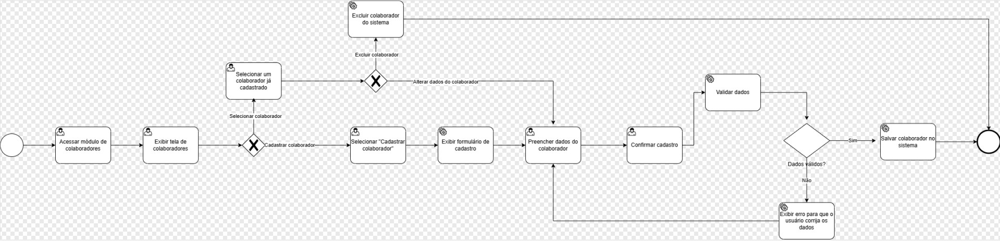

### 3.3.2 Processo 1 – GESTÃO DE USUÁRIO

O processo de **Gestão de Usuário** tem como objetivo permitir o cadastro e manutenção das informações dos colaboradores da empresa, garantindo maior organização dos dados, rastreabilidade e apoio aos demais processos do sistema, como agendamento, prestação de serviços e cálculo de comissão.

Atualmente, em muitos pequenos negócios, o controle de colaboradores é feito de maneira informal ou por meio de planilhas, o que pode gerar inconsistências cadastrais, retrabalho e dificuldade de integração com outros processos da operação. Com a informatização desse processo, será possível centralizar as informações dos profissionais, melhorar a confiabilidade dos dados e aumentar a eficiência administrativa do negócio.

#### Oportunidades de melhoria

A informatização do processo de Gestão de Colaborador traz as seguintes oportunidades de melhoria:

• centralização das informações cadastrais em um único sistema;

• redução de erros decorrentes de controles manuais;

• facilidade para localizar e atualizar dados dos profissionais;

• integração com processos de agendamento e comissão;

• maior segurança no acesso às informações;

• melhor rastreabilidade das alterações realizadas no cadastro.

---

Em seguida, apresenta-se o modelo do processo de Gestão de Colaborador, descrito no padrão BPMN:

 

---

## Detalhamento das atividades

### Exibir colaboradores

| **Campo**                  | **Tipo**           | **Restrições**             | **Valor padrão**           |
| ---------------------- | -------------- | ---------------------- | ---------------------- |
| lista de colaboradores | Tabela         | somente leitura        | carregada pelo sistema |
| campo de busca         | Caixa de texto | preenchimento opcional | vazio                  |
| filtro de status       | Seleção única  | ativo / inativo        | todos                  |

| **Comandos**           | **Destino**                          | **Tipo**     |
| --------------------- | --------------------------------- | -------- |
| cadastrar colaborador | Atividade "Cadastrar colaborador" | padrão   |
| alterar colaborador   | Atividade "Alterar colaborador"   | padrão   |
| excluir colaborador   | Atividade "Excluir colaborador"   | padrão   |
| voltar                | Fim do processo                   | cancelar |

---

### Cadastrar colaborador

| **Campo**                  | **Tipo**           | **Restrições**             | **Valor padrão**           |
| ------------------- | -------------- | ------------------- | ------------ |
| nome completo       | Caixa de texto | obrigatório         | vazio        |
| CPF                 | Caixa de texto | obrigatório e único | vazio        |
| endereço            | Área de texto  | obrigatório         | vazio        |
| data de nascimento  | Data           | obrigatório         | vazio        |
| telefone            | Caixa de texto | obrigatório         | vazio        |
| e-mail              | Caixa de texto | obrigatório         | vazio        |
| data de contratação | Data           | obrigatório         | data atual   |

| **Comandos**           | **Destino**                          | **Tipo**     |
| -------- | -------------------------------- | -------- |
| salvar   | Atividade "Exibir colaboradores" | padrão   |
| cancelar | Atividade "Exibir colaboradores" | cancelar |

---

### Alterar colaborador

| **Campo**                  | **Tipo**           | **Restrições**             | **Valor padrão**           |
| ------------------- | -------------- | ------------------- | ------------ |
| nome completo       | Caixa de texto | obrigatório         | valor atual  |
| CPF                 | Caixa de texto | obrigatório e único | valor atual  |
| endereço            | Área de texto  | obrigatório         | valor atual  |
| telefone            | Caixa de texto | obrigatório         | valor atual  |
| e-mail              | Caixa de texto | obrigatório         | valor atual  |
| data de contratação | Data           | obrigatório         | valor atual  |

| **Comandos**           | **Destino**                          | **Tipo**     |
| ----------------- | -------------------------------- | -------- |
| salvar alterações | Atividade "Exibir colaboradores" | padrão   |
| cancelar          | Atividade "Exibir colaboradores" | cancelar |

---

### Excluir colaborador

| **Campo**                  | **Tipo**           | **Restrições**             | **Valor padrão**           |
| ----------------------- | -------------- | --------------- | ------------------- |
| colaborador selecionado | Caixa de texto | somente leitura | nome do colaborador |
| confirmação de exclusão | Seleção        | sim / não       | não                 |

| **Comandos**           | **Destino**                          | **Tipo**     |
| ------------------ | -------------------------------- | -------- |
| confirmar exclusão | Atividade "Exibir colaboradores" | padrão   |
| cancelar           | Atividade "Exibir colaboradores" | cancelar |
