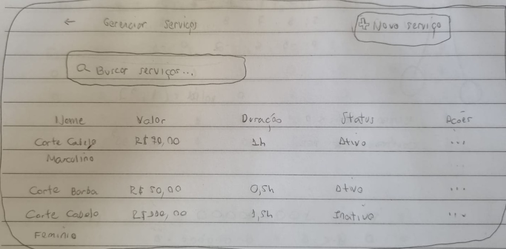
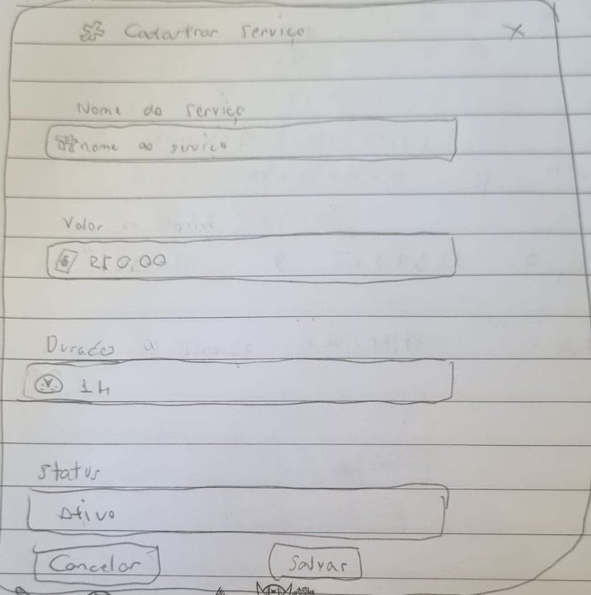
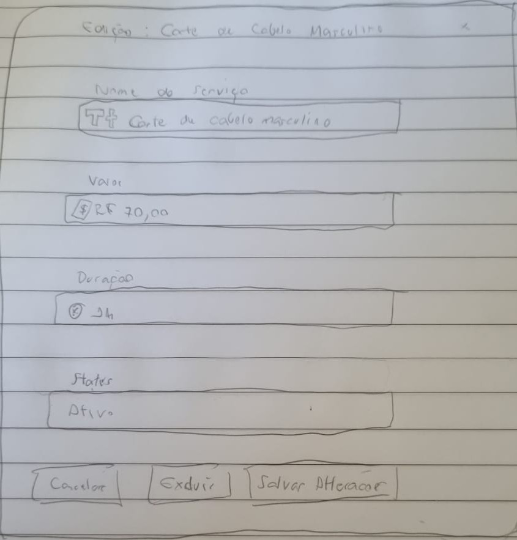

### 3.3.2 Processo 2 – GESTÃO DE SERVIÇO

O processo de **Gestão de Serviço** tem como objetivo permitir o cadastro e manutenção das informações relacionados aos serviços prestados pela empresa. O cadastro de serviços permite que eles sejam exibidos a todos os clientes com informações padronizadas e estruturadas, além de permitir que colaboradores tenham a facilidade de registrar o leque de serviços que estão aptos a prestar.

#### Oportunidades de melhoria

• padronização dos nomes, valores e tempo de execução dos serviços prestados no estabelicimento

• facilitação na alteração, exclusão ou inclusão de serviços no sistema

• facilitação na distribuição das informações dos serviços disponíveis para os clientes

#### Detalhamento das atividades

---

#### Gerenciar de Serviços

| **Campo**       | **Tipo**       | **Restrições**                               | **Valor default**  |
| ---             | ---            | ---                                          | ---                |
| buscar_servicos | Caixa de texto | máximo de 30 caracteres                      | Buscar Serviços    |
| lista_servicos  | Tabela         | colunas: nome, valor, duração, status, ações | carregado do banco |

| **Comandos**   |  **Destino**      | **Tipo** |
| ---            | ---               | ---      |
| novo_servico   | Cadastrar Serviço | default  |
| editar_servico | Editar Serviço    | default  |
| voltar         | Tela anterior     | cancel   |

---

#### Cadastrar Serviço

| **Campo**    | **Tipo**       | **Restrições**                       | **Valor default**  |
| ---          | ---            | ---                                  | ---                |
| nome_servico | Caixa de texto | obrigatório, máximo de 30 caracteres | vazio              |
| valor        | Número         | obrigatório, >= 0                    | 0,00               |
| duracao      | Caixa de texto | obrigatório                          | vazio              |
| status       | Seleção única  | valores: Ativo, Inativo              | Ativo              |

| **Comandos** |  **Destino**       | **Tipo** |
| ---          | ---                | ---      |
| salvar       | Gerenciar Serviços | default  |
| cancelar     | Gerenciar Serviços | default  |

#### Editar Serviço

| **Campo**    | **Tipo**       | **Restrições**                       | **Valor default**  |
| ---          | ---            | ---                                  | ---                |
| nome_servico | Caixa de texto | obrigatório, máximo de 30 caracteres | valor existente    |
| valor        | Número         | obrigatório, >= 0                    | valor existente    |
| duracao      | Caixa de texto | obrigatório                          | valor existente    |
| status       | Seleção única  | valores: Ativo, Inativo              | valor existente    |

| **Comandos**      |  **Destino**       | **Tipo** |
| ---               | ---                | ---      |
| salvar_alteracoes | Gerenciar Serviços | default  |
| excluir           | Prompt Confirmação | default  |
| cancelar          | Gerenciar Serviços | cancel   |

---
 
## Wireframe

---

### Gerenciar Serviços

### Cadastrar Serviço

### Editar de Serviço
