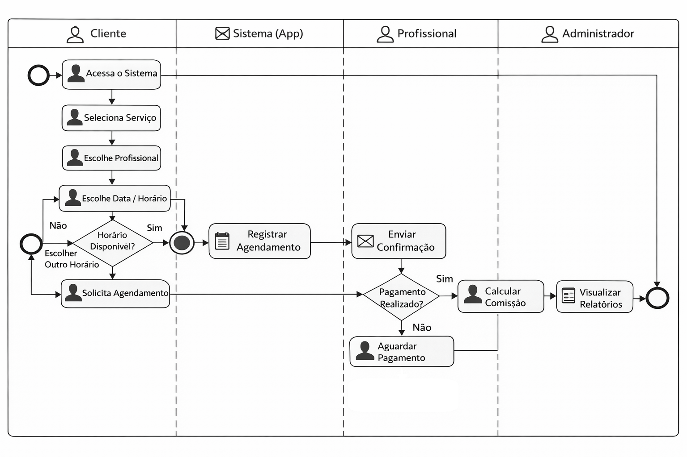
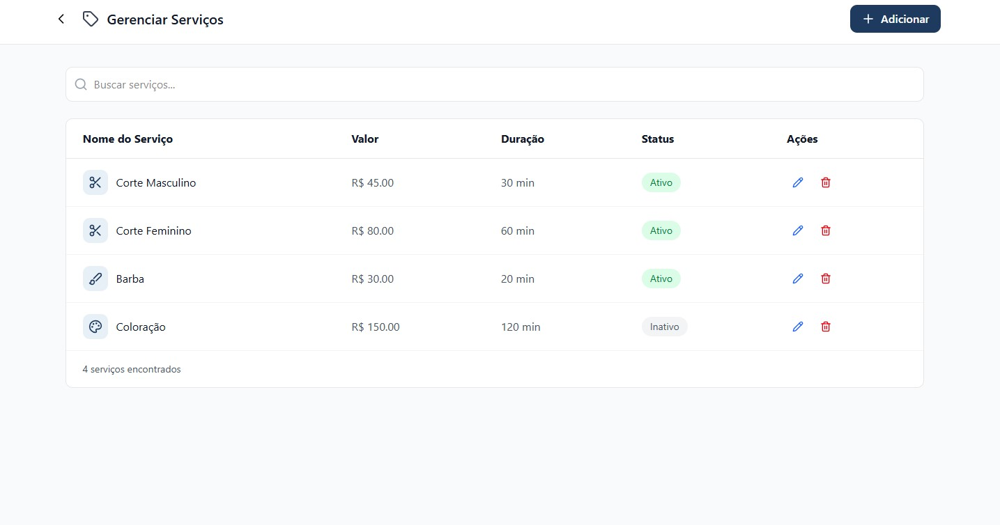
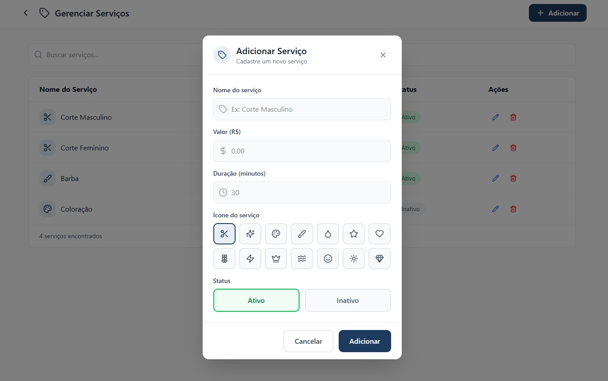
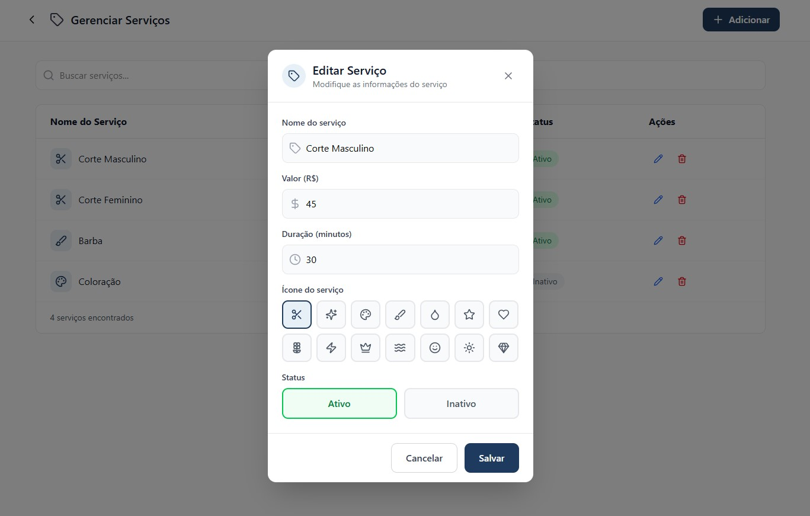
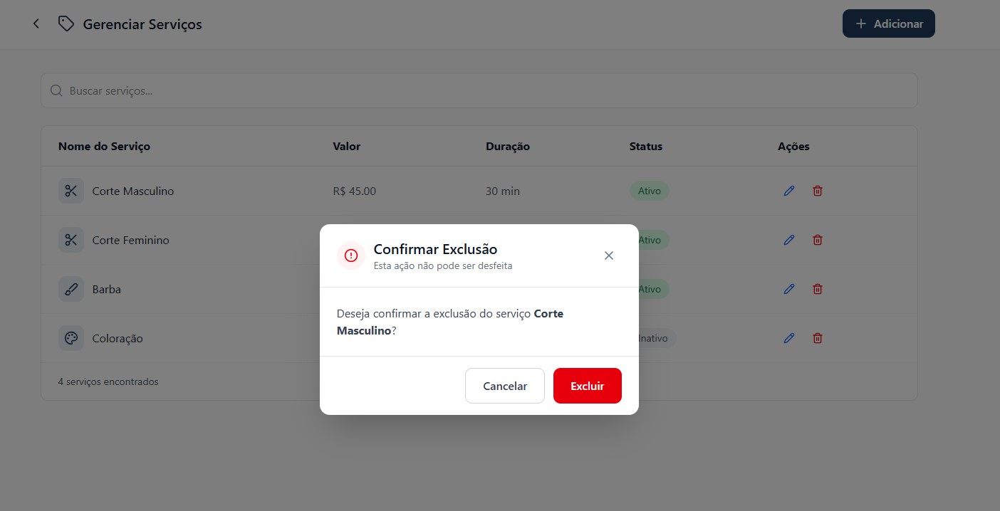

# 3.3.2 Processo 2 – GESTÃO DE SERVIÇO

O processo de **Gestão de Serviço** tem como objetivo permitir o cadastro e manutenção das informações relacionados aos serviços prestados pela empresa. O cadastro de serviços permite que eles sejam exibidos a todos os clientes com informações padronizadas e estruturadas, além de permitir que colaboradores tenham a facilidade de registrar o leque de serviços que estão aptos a prestar.

## Oportunidades de melhoria

A informatização do processo de Gestão de Serviço traz as seguintes oportunidades de melhoria:

• padronização dos serviços oferecidos pela empresa, evitando inconsistências na descrição, duração e valores;

• centralização das informações dos serviços em um único sistema, facilitando o acesso e a manutenção dos dados;

• redução de erros operacionais decorrentes do uso de controles manuais ou planilhas;

• facilidade na atualização de valores e duração dos serviços, permitindo maior flexibilidade na gestão do negócio;

• integração com o processo de agendamento, garantindo que os horários sejam definidos corretamente com base na duração dos serviços;

• apoio ao cálculo automático de comissões, uma vez que os serviços estarão previamente cadastrados com seus respectivos valores;

• melhoria na organização e no controle do portfólio de serviços oferecidos pela empresa;

• maior agilidade no atendimento ao cliente, uma vez que os serviços já estarão estruturados no sistema;

• aumento da confiabilidade das informações utilizadas nos processos financeiros e operacionais.

## Modelagem

Em seguida, apresenta-se o modelo do processo de Gestão de Serviço, descrito no padrão BPMN:

## Subprocesso 1 – Gerenciamento de Serviços

O subprocesso de **Gerenciamento de Serviços** tem como objetivo permitir que o administrador gerencie e visualize os serviços oferecidos pelo estabelecimento. O subprocesso se inicia na tela principal do módulo de gerenciamento de serviços em que apresenta a relação de todos os serviços cadastrados no sistema, com suporte a busca por nome. A partir desta tela, o administrador pode adicionar um novo serviço ou selecionar um serviço existente para edição.

### Detalhamento das atividades

#### Exibir lista de serviços
 
| **Campo**          | **Tipo**       | **Restrições**                  | **Valor padrão**       |
| ------------------ | -------------- | ------------------------------- | ---------------------- |
| busca de serviços  | Caixa de texto | preenchimento opcional          | vazio                  |
| lista de serviços  | Tabela         | somente leitura                 | carregada pelo sistema |
| nome do serviço    | Coluna         | somente leitura                 | vazio                  |
| valor              | Coluna         | somente leitura                 | vazio                  |
| duração            | Coluna         | somente leitura                 | vazio                  |
| status             | Coluna         | somente leitura (ativo/inativo) | vazio                  |
 
| **Comandos** | **Destino**                               | **Tipo** |
| ---          | ---                                       | -------- |
| Adicionar    | Atividade "Abrir modal Adicionar Serviço" | padrão   |
| Editar       | Atividade "Abrir modal Editar Serviço"    | padrão   |
| Excluir      | Atividade "Abrir modal Excluir Serviço"   | padrão   |
| Voltar       | Fim do processo                           | cancelar |

### Wireframes

## Subrocesso 2 – Cadastro de Serviço

O subprocesso de **Cadastro de Serviço** se inicia com o administrador acionando o botão "Adicionar". O sistema exibe o modal de cadastro de novo serviço com todos os campos em branco, aguardando preenchimento. O administrador preenche os campos do formulário de cadastro de novo serviço. Em seguida, os dados preenchidos no formulário de adição são verificados pelo sistema quanto ao cumprimento das restrições definidas. Não há interação direta do administrador nesta etapa. Caso haja erro, o sistema exibe uma mensagem de erro indicando quais campos estão incorretos ou incompletos. O administrador então retorna ao formulário para efetuar as correções necessárias. Após a validação bem-sucedida dos dados, o novo serviço é registrado no banco de dados e o sistema retorna para a tela de listagem com o serviço incluído.

### Detalhamento das atividades

#### Preencher formulário
 
| **Campo**         | **Tipo**       | **Restrições**               | **Valor padrão** |
| ----------------- | -------------- | ---------------------------- | ---------------- |
| nome do serviço   | Caixa de texto | obrigatório                  | vazio            |
| valor (R$)        | Numérico       | obrigatório; maior que zero  | 0.00             |
| duração (minutos) | Numérico       | obrigatório; maior que zero  | 30               |
| icone (minutos)   | Seleção única  | obrigatório                  | Ícone Tesoura    |
| status            | Seleção única  | Ativo / Inativo              | Ativo            |
 
| **Comandos** | **Destino**                          | **Tipo** |
| ------------ | ------------------------------------ | -------- |
| Adicionar    | Atividade "Validar dados"            | padrão   |
| Cancelar     | Atividade "Exibir lista de serviços" | cancelar |

### Wireframes

## Subprocesso 3 – Edição de Serviço

O subprocesso **Edição de Serviço** se inicia com o administrador acionando o botão de edição de um serviço. O sistema exibe o modal de edição com os campos preenchidos com os dados atuais do serviço selecionado. O administrador modifica os campos do formulário de edição do serviço selecionado. O administrador pode também acionar a exclusão do serviço diretamente nesta tela. Após a confirmação das alterações pelo administrador, o registro existente é atualizado no banco de dados com os novos valores informados e o sistema retorna para a tela de listagem. Caso o administrador selecione "Excluir", o sistema solicita a confirmação do administrador antes de remover o serviço. Caso o administrador cancele, retorna ao modal de edição sem realizar alterações. Após a confirmação da exclusão, o registro do serviço é removido do banco de dados e o sistema retorna para a tela de listagem atualizada.

#### Editar dados do serviço
 
| **Campo**         | **Tipo**       | **Restrições**               | **Valor padrão** |
| ----------------- | -------------- | ---------------------------- | ---------------- |
| nome do serviço   | Caixa de texto | obrigatório                  | valor atual      |
| valor (R$)        | Numérico       | obrigatório; maior que zero  | valor atual      |
| duração (minutos) | Numérico       | obrigatório; maior que zero  | valor atual      |
| status            | Seleção única  | Ativo / Inativo              | valor atual      |
 
| **Comandos** | **Destino**                          | **Tipo** |
| ------------ | ------------------------------------ | -------- |
| Salvar       | Atividade "Salvar edição do serviço" | padrão   |
| Excluir      | Atividade "Confirmar exclusão"       | destrutivo |
| Cancelar     | Atividade "Exibir lista de serviços" | cancelar |
 
---
 
#### Confirmar exclusão
 
| **Campo**               | **Tipo** | **Restrições**  | **Valor padrão**              |
| ----------------------- | -------- | --------------- | ----------------------------- |
| serviço selecionado     | Exibição | somente leitura | nome do serviço a excluir     |
| confirmação de exclusão | Seleção  | confirmar / cancelar | cancelar                 |
 
| **Comandos**       | **Destino**                            | **Tipo**   |
| ------------------ | -------------------------------------- | ---------- |
| confirmar exclusão | Atividade "Editar dados do serviço"    | destrutivo |
| cancelar           | Atividade "Editar dados do serviço"    | cancelar   |
 
### Wireframes

### Exibir Serviços

### Editar Serviço

### Excluir Serviço

### Cadastrar Serviço

