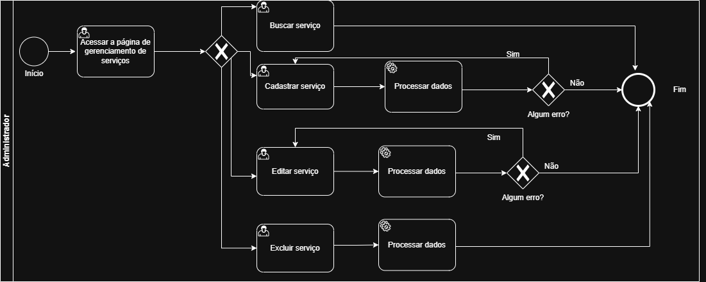
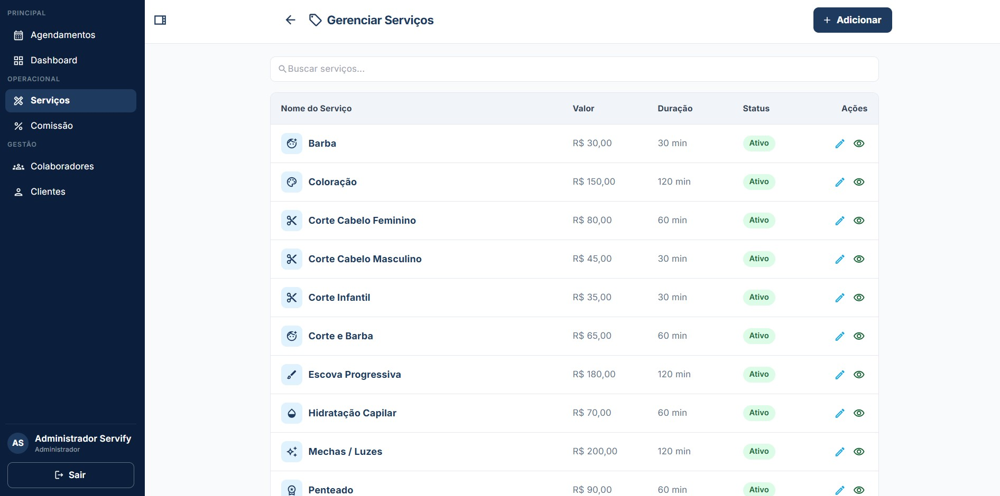
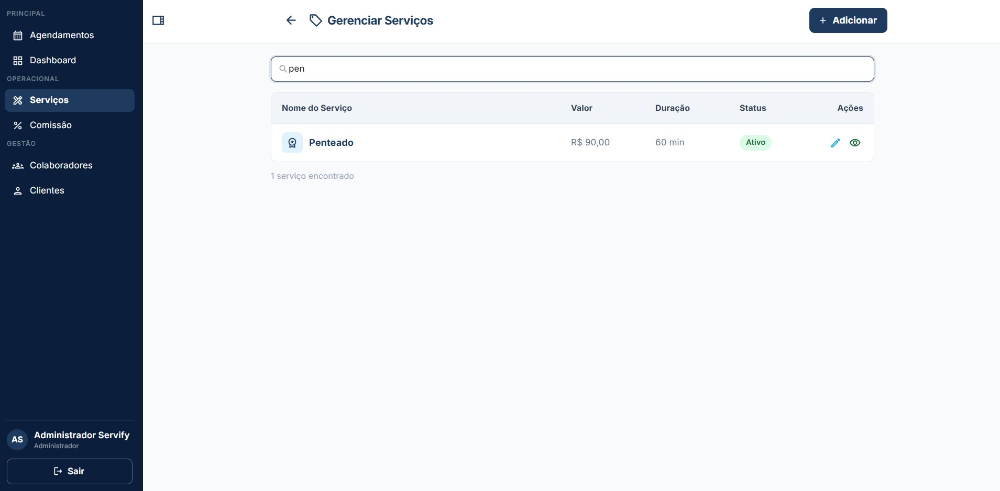
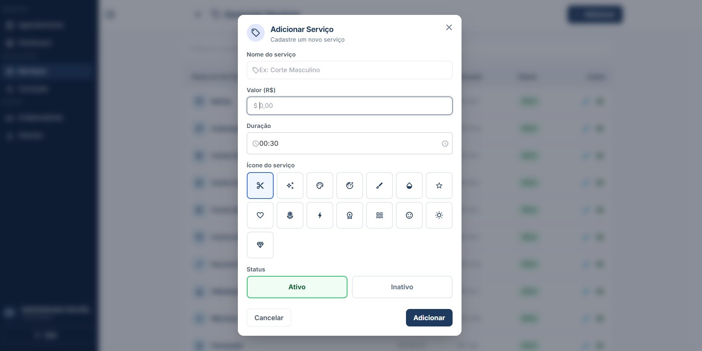
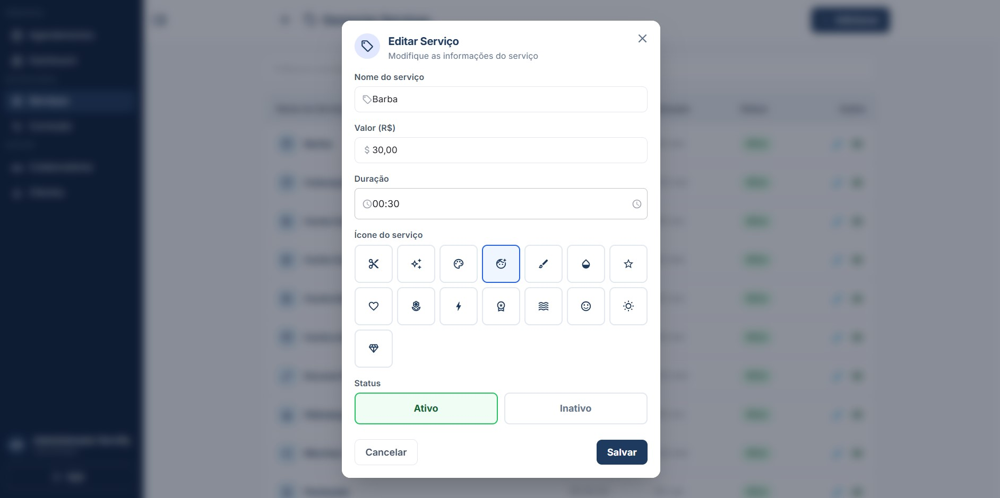
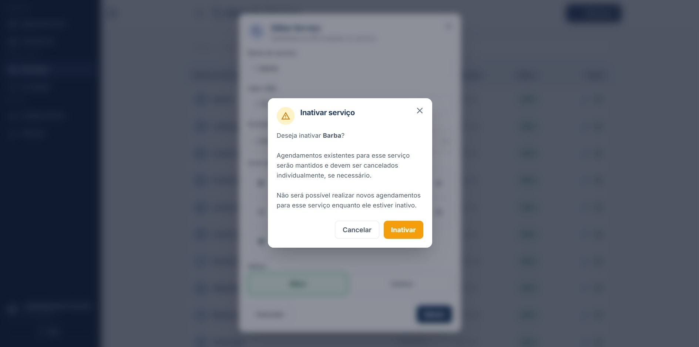

# 3.3.2 Processo 2 – GESTÃO DE SERVIÇO

O processo de **Gestão de Serviço** tem como objetivo permitir o cadastro e manutenção das informações relacionados aos serviços prestados pela empresa. O cadastro de serviços permite que eles sejam exibidos a todos os clientes com informações padronizadas e estruturadas, além de permitir que colaboradores tenham a facilidade de registrar o leque de serviços que estão aptos a prestar.

## Oportunidades de melhoria

A informatização do processo de Gestão de Serviço traz as seguintes oportunidades de melhoria:

• padronização dos serviços oferecidos pela empresa, evitando inconsistências na descrição, duração e valores;

• centralização das informações dos serviços em um único sistema, facilitando o acesso e a manutenção dos dados;

• redução de erros operacionais decorrentes do uso de controles manuais ou planilhas;

• facilidade na atualização de valores e duração dos serviços, permitindo maior flexibilidade na gestão do negócio;

• integração com o processo de agendamento, garantindo que os horários sejam definidos corretamente com base na duração dos serviços;

• apoio ao cálculo automático de comissões, uma vez que os serviços estarão previamente cadastrados com seus respectivos valores;

• melhoria na organização e no controle do portfólio de serviços oferecidos pela empresa;

• maior agilidade no atendimento ao cliente, uma vez que os serviços já estarão estruturados no sistema;

• aumento da confiabilidade das informações utilizadas nos processos financeiros e operacionais.

## Modelagem

Em seguida, apresenta-se o modelo do processo de Gestão de Serviço, descrito no padrão BPMN:

## Subprocesso 1 – Gerenciamento de Serviços

O subprocesso de **Gerenciamento de Serviços** tem como objetivo permitir que o administrador gerencie e visualize os serviços oferecidos pelo estabelecimento. O subprocesso se inicia na tela principal do módulo de gerenciamento de serviços em que apresenta a relação de todos os serviços cadastrados no sistema, com suporte a busca por nome. A partir desta tela, o administrador pode adicionar um novo serviço, selecionar um serviço existente para edição ou selecionar um serviço existente para exclusão.

### Detalhamento das atividades

#### Exibir lista de serviços
 
| **Campo**          | **Tipo**       | **Restrições**                  | **Valor padrão**       |
| ------------------ | -------------- | ------------------------------- | ---------------------- |
| Buscar serviços  | Caixa de texto | preenchimento opcional          | vazio                  |
| Lista de serviços  | Tabela         | somente leitura                 | carregada pelo sistema |
| Nome do serviço    | Coluna         | somente leitura                 | vazio                  |
| Valor              | Coluna         | somente leitura                 | vazio                  |
| Duração            | Coluna         | somente leitura                 | vazio                  |
| Status             | Coluna         | somente leitura (ativo/inativo) | vazio                  |
 
| **Comandos** | **Destino**                               | **Tipo** |
| ---          | ---                                       | -------- |
| Adicionar    | Atividade "Abrir modal Adicionar Serviço" | padrão   |
| Editar       | Atividade "Abrir modal Editar Serviço"    | padrão   |
| Excluir      | Atividade "Abrir modal Excluir Serviço"   | padrão   |
| Voltar       | Atividade "Acessar a lista de agendamentos"   | padrão |

| **Resultado**             | **Destino**                                      |
| ------------------------- | ------------------------------------------------ |
| Serviço encontrado       | Listagem filtrada pelo termo digitado            |
| Nenhum resultado          | Listagem vazia                                   |
| Busca apagada             | Retorno à listagem completa                      |
| Modal de cadastro aberto  | Atividade "Cadastrar serviço"                   |
| Modal de edição aberto    | Atividade "Editar serviço"                      |
| Modal de exclusão aberto  | Atividade "Excluir serviço"                     |

### Wireframes

## Subrocesso 2 – Cadastro de Serviço

O subprocesso de **Cadastro de Serviço** se inicia com o administrador acionando o botão "Adicionar". O sistema exibe o modal de cadastro de novo serviço com todos os campos em branco, aguardando preenchimento sendo eles: nome do serviço, valor, duração, ícone e status. O administrador preenche os campos do formulário de cadastro de novo serviço. Caso haja algum erro, o usuário recebe uma mensagem de erro indicando quais campos estão incorretos ou incompletos. O administrador então retorna ao formulário para efetuar as correções necessárias. Após a validação bem-sucedida dos dados, uma mensagem de serviço registrado com sucesso aparece e ele retorna automaticamente para a tela de listagem com o serviço incluído.

### Detalhamento das atividades

#### Cadastro de serviço
 
| **Campo**         | **Tipo**       | **Restrições**               | **Valor padrão** |
| ----------------- | -------------- | ---------------------------- | ---------------- |
| Nome do serviço   | Caixa de texto | obrigatório                  | vazio            |
| Valor (R$)        | Numérico       | obrigatório; maior que zero  | 0.00             |
| Duração (minutos) | Numérico       | obrigatório; maior que zero  | 30               |
| Ícone   | Seleção única  | obrigatório                  | Ícone Tesoura    |
| Status            | Seleção única  | Ativo / Inativo              | Ativo            |
 
| **Comandos** | **Destino**                          | **Tipo** |
| ------------ | ------------------------------------ | -------- |
| Adicionar    | Atividade "Exibir lista de serviços"            | padrão   |
| Cancelar     | Atividade "Exibir lista de serviços" | cancelar |
| X (fechar)            | Atividade "Exibir lista de serviços"              | cancelar |

| **Resultado**             | **Destino**                                      |
| ------------------------- | ------------------------------------------------ |
| Serviço cadastado       | Toast "Serviço cadastrado com sucesso." e Atividade "Exibir lista de serviços"            |
| Prompt de erro    | "Campo inválido." |
| Operação cancelada    | Atividade "Exibir lista de serviços" |

### Wireframes

## Subprocesso 3 – Edição de Serviço

O subprocesso **Edição de Serviço** se inicia com o administrador acionando o botão de edição de um serviço. O sistema exibe o modal de edição com os campos preenchidos com os dados atuais do serviço selecionado e os botões de Salvar e Cancelar. O administrador modifica os campos do formulário de edição do serviço selecionado e clica em "Salvar". Após a confirmação das alterações pelo administrador, o registro existente é atualizado e o usuário retorna automaticamente para a tela de listagem com o serviço ajustado. Caso o administrador opte por cancelar a operação, o modal de edição é fechado e o usuário retorna automaticamente para a tela de listagem. Caso haja algum erro na edição, uma mensagem de erro aparece para o usuário.

### Detalhamento das atividades

#### Edição de Serviço
 
| **Campo**         | **Tipo**       | **Restrições**               | **Valor padrão** |
| ----------------- | -------------- | ---------------------------- | ---------------- |
| Nome do serviço   | Caixa de texto | obrigatório                  | valor atual      |
| Valor (R$)        | Numérico       | obrigatório; maior que zero  | valor atual      |
| Duração (minutos) | Numérico       | obrigatório; maior que zero  | valor atual      |
| Ícone   | Seleção única  | obrigatório                  | valor atual    |
| Status            | Seleção única  | Ativo / Inativo              | valor atual      |
 
| **Comandos** | **Destino**                          | **Tipo** |
| ------------ | ------------------------------------ | -------- |
| Salvar       | Atividade "Exibir lista de serviços" | padrão   |
| Cancelar     | Atividade "Exibir lista de serviços" | cancelar |
| X (fechar)            | Atividade "Exibir lista de serviços"              | cancelar |

| **Resultado**             | **Destino**                                      |
| ------------------------- | ------------------------------------------------ |
| Serviço alterado       | Atividade "Exibir lista de serviços"            |
| Prompt de erro    | "Campo inválido." |
| Operação cancelada    | Atividade "Exibir lista de serviços" |
 
### Wireframes

## Subprocesso 4 – Exclusão de Serviço

O subprocesso de **Exclusão de Serviço** se inicia com o administrador acionando o botão de exclusão de um serviço (lixeira). O modal de confirmação de exclusão é exibido ao usuário junto com as opções de Excluir, Cancelar e X. Caso o usuário clique em Excluir, uma mensagem de "Serviço excluído com sucesso." é exibida e o usuário retorna à listagem de serviços com o serviço excluído. Caso clique em Cancelar ou X, a operação é cancelada e o usuário retorna para a listagem de serviços.

### Detalhamento das atividades

#### Confirmar exclusão
 
| **Campo**               | **Tipo** | **Restrições**  | **Valor padrão**              |
| ----------------------- | -------- | --------------- | ----------------------------- |
| Serviço selecionado     | Exibição | somente leitura | nome do serviço a excluir     |
| Confirmação de exclusão | Seleção  | confirmar / cancelar | cancelar                 |
 
| **Comandos**       | **Destino**                            | **Tipo**   |
| ------------------ | -------------------------------------- | ---------- |
| Excluir | Atividade "Exibir lista de serviços"    | destrutivo |
| Cancelar           | Atividade "Exibir lista de serviços"    | cancelar   |

| **Resultado**             | **Destino**                                      |
| ------------------------- | ------------------------------------------------ |
| Serviço excluído       | Toast de "Serviço excluído com sucesso." e Atividade "Exibir lista de serviços"            |
| Operação cancelada    | Atividade "Exibir lista de serviços" |

### Wireframes

