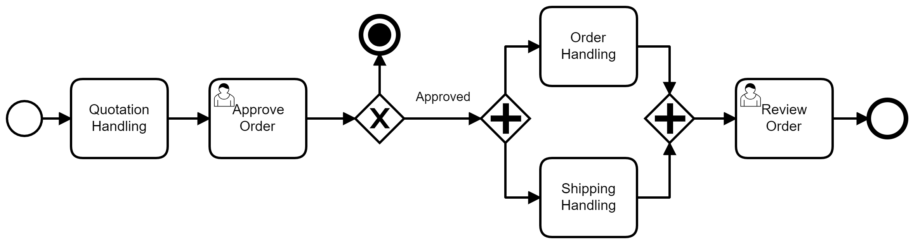
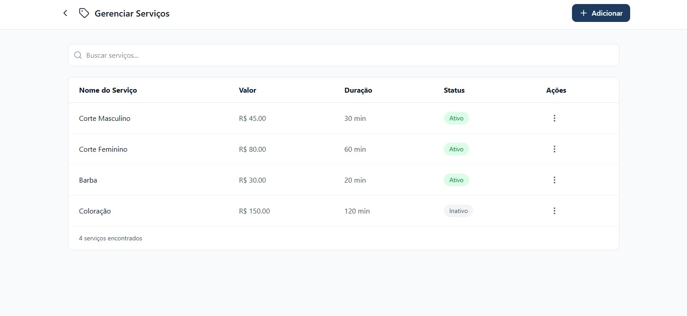
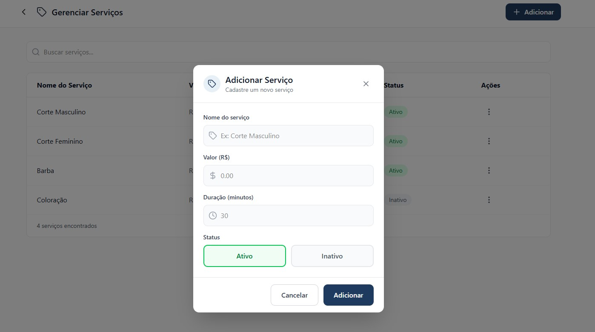
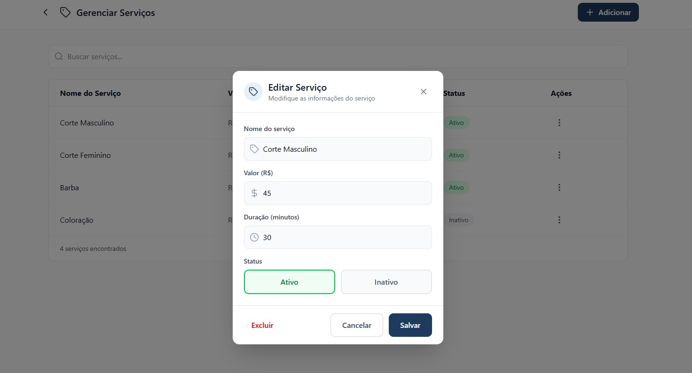

# 3.3.2 Processo 2 – GESTÃO DE SERVIÇO

---

O processo de **Gestão de Serviço** tem como objetivo permitir o cadastro e manutenção das informações relacionados aos serviços prestados pela empresa. O cadastro de serviços permite que eles sejam exibidos a todos os clientes com informações padronizadas e estruturadas, além de permitir que colaboradores tenham a facilidade de registrar o leque de serviços que estão aptos a prestar.

---

## Oportunidades de melhoria

---

A informatização do processo de Gestão de Serviço traz as seguintes oportunidades de melhoria:

• padronização dos nomes, valores e tempo de execução dos serviços prestados no estabelicimento;

• facilitação na alteração, exclusão ou inclusão de serviços no sistema;

• facilitação na distribuição das informações dos serviços disponíveis para os clientes.

---

## Modelagem

---

Em seguida, apresenta-se os modelos do processo de Gestão de Serviço, descritos no padrão BPMN:

---

## Detalhamento das atividades

---

## Processo 1 – Gerenciamento de serviços

O processo de **Gerenciamento de Serviços** tem como objetivo permitir que o administrador gerencie e visualize os serviços oferecidos pelo estabelecimento. O processo se inicia na tela principal do módulo de gerenciamento de serviços em que apresenta a relação de todos os serviços cadastrados no sistema, com suporte a busca por nome. A partir desta tela, o administrador pode adicionar um novo serviço ou selecionar um serviço existente para edição.

## Processo 2 – Cadastro de Serviço

O processo de Cadastro de Serviço se inicia com o administrador acionando o botão "+Adicionar". O sistema exibe o modal de cadastro de novo serviço com todos os campos em branco, aguardando preenchimento. O administrador preenche os campos do formulário de cadastro de novo serviço. Em seguida, os dados preenchidos no formulário de adição são verificados pelo sistema quanto ao cumprimento das restrições definidas. Não há interação direta do administrador nesta etapa. Caso haja erro, o sistema exibe uma mensagem de erro indicando quais campos estão incorretos ou incompletos. O administrador então retorna ao formulário para efetuar as correções necessárias. Após a validação bem-sucedida dos dados, o novo serviço é registrado no banco de dados e o sistema retorna para a tela de listagem com o serviço incluído.

## Processo 3 – Edição de Serviço

O processo Edição de Serviço se inicia com o administrador acionando o menu de ações (⋮) de um serviço existente e seleciona a opção de edição. O sistema exibe o modal de edição com os campos preenchidos com os dados atuais do serviço selecionado. O administrador modifica os campos do formulário de edição do serviço selecionado. Os campos são pré-carregados com os valores atuais do registro. O administrador pode também acionar a exclusão do serviço diretamente nesta tela. Após a confirmação das alterações pelo administrador, o registro existente é atualizado no banco de dados com os novos valores informados e o sistema retorna para a tela de listagem. Caso o administrador selecione "Excluir", o sistema solicita a confirmação do administrador antes de remover o serviço. Caso o administrador cancele, retorna ao modal de edição sem realizar alterações. Após a confirmação da exclusão, o registro do serviço é removido do banco de dados e o sistema retorna para a tela de listagem atualizada.

## Processos

---

## Processo 1 – Gerenciamento de serviços

---

#### Exibir lista de serviços
 
| **Campo**          | **Tipo**       | **Restrições**                  | **Valor padrão**       |
| ------------------ | -------------- | ------------------------------- | ---------------------- |
| lista de serviços  | Tabela         | somente leitura                 | carregada pelo sistema |
| nome do serviço    | Coluna         | somente leitura                 | —                      |
| valor (R$)         | Coluna         | somente leitura                 | —                      |
| duração            | Coluna         | somente leitura                 | —                      |
| status             | Coluna         | somente leitura (ativo/inativo) | —                      |
| campo de busca     | Caixa de texto | preenchimento opcional          | vazio                  |
 
| **Comandos**       | **Destino**                              | **Tipo** |
| ------------------ | ---------------------------------------- | -------- |
| + Adicionar        | Atividade "Abrir modal Adicionar Serviço" | padrão  |
| ⋮ (ações)          | Atividade "Abrir modal Editar Serviço"   | padrão   |
| ← voltar           | Fim do processo                          | cancelar |
 
---

## Processo 2 – Cadastro de Serviço

---
 
#### Abrir modal Adicionar Serviço
 
| **Campo**           | **Tipo** | **Restrições**  | **Valor padrão**        |
| ------------------- | -------- | --------------- | ----------------------- |
| modal de cadastro   | Exibição | somente leitura | exibido pelo sistema    |
 
| **Comandos** | **Destino**                          | **Tipo** |
| ------------ | ------------------------------------ | -------- |
| preencher    | Atividade "Preencher formulário"     | padrão   |
| Cancelar     | Atividade "Exibir lista de serviços" | cancelar |
 
---
 
#### Abrir modal Editar Serviço
 
| **Campo**           | **Tipo** | **Restrições**  | **Valor padrão**               |
| ------------------- | -------- | --------------- | ------------------------------ |
| modal de edição     | Exibição | somente leitura | exibido pelo sistema           |
 
| **Comandos** | **Destino**                            | **Tipo** |
| ------------ | -------------------------------------- | -------- |
| preencher    | Atividade "Editar dados do serviço"    | padrão   |
| Cancelar     | Atividade "Exibir lista de serviços"   | cancelar |
 
---
 
#### Preencher formulário
 
| **Campo**         | **Tipo**       | **Restrições**               | **Valor padrão** |
| ----------------- | -------------- | ---------------------------- | ---------------- |
| nome do serviço   | Caixa de texto | obrigatório                  | vazio            |
| valor (R$)        | Numérico       | obrigatório; maior que zero  | 0.00             |
| duração (minutos) | Numérico       | obrigatório; maior que zero  | 30               |
| status            | Seleção única  | Ativo / Inativo              | Ativo            |
 
| **Comandos** | **Destino**                          | **Tipo** |
| ------------ | ------------------------------------ | -------- |
| Adicionar    | Atividade "Validar dados"            | padrão   |
| Cancelar     | Atividade "Exibir lista de serviços" | cancelar |
 
---

## Processo 3 – Edição de Serviço

---
 
#### Editar dados do serviço
 
| **Campo**         | **Tipo**       | **Restrições**               | **Valor padrão** |
| ----------------- | -------------- | ---------------------------- | ---------------- |
| nome do serviço   | Caixa de texto | obrigatório                  | valor atual      |
| valor (R$)        | Numérico       | obrigatório; maior que zero  | valor atual      |
| duração (minutos) | Numérico       | obrigatório; maior que zero  | valor atual      |
| status            | Seleção única  | Ativo / Inativo              | valor atual      |
 
| **Comandos** | **Destino**                          | **Tipo** |
| ------------ | ------------------------------------ | -------- |
| Salvar       | Atividade "Salvar edição do serviço" | padrão   |
| Excluir      | Atividade "Confirmar exclusão"       | destrutivo |
| Cancelar     | Atividade "Exibir lista de serviços" | cancelar |
 
---
 
#### Validar dados
 
| **Campo**         | **Tipo** | **Restrições**                              | **Valor padrão** |
| ----------------- | -------- | ------------------------------------------- | ---------------- |
| nome do serviço   | Interno  | não pode ser vazio                          | —                |
| valor (R$)        | Interno  | não pode ser vazio; deve ser maior que zero | —                |
| duração (minutos) | Interno  | não pode ser vazio; deve ser maior que zero | —                |
| status            | Interno  | deve ser Ativo ou Inativo                   | —                |
 
| **Resultado**        | **Destino**                          |
| -------------------- | ------------------------------------ |
| dados válidos        | Atividade "Salvar serviço"           |
| dados inválidos      | Atividade "Exibir erro de validação" |
 
---
 
#### Exibir erro de validação
 
| **Campo**        | **Tipo** | **Restrições**  | **Valor padrão**                       |
| ---------------- | -------- | --------------- | -------------------------------------- |
| mensagem de erro | Exibição | somente leitura | descrição do(s) campo(s) com problema  |
 
| **Comandos** | **Destino**                      | **Tipo** |
| ------------ | -------------------------------- | -------- |
| corrigir     | Atividade "Preencher formulário" | padrão   |
 
---
 
#### Salvar serviço
 
| **Campo**           | **Tipo** | **Restrições**  | **Valor padrão**                    |
| ------------------- | -------- | --------------- | ----------------------------------- |
| dados do serviço    | Interno  | somente leitura | dados validados na etapa anterior   |
 
| **Resultado**     | **Destino**                          |
| ----------------- | ------------------------------------ |
| salvo com sucesso | Atividade "Exibir lista de serviços" |
 
---
 
#### Salvar edição do serviço
 
| **Campo**           | **Tipo** | **Restrições**  | **Valor padrão**                       |
| ------------------- | -------- | --------------- | -------------------------------------- |
| dados atualizados   | Interno  | somente leitura | dados editados pelo administrador      |
 
| **Resultado**        | **Destino**                          |
| -------------------- | ------------------------------------ |
| salvo com sucesso    | Atividade "Exibir lista de serviços" |
 
---
 
#### Confirmar exclusão
 
| **Campo**               | **Tipo** | **Restrições**  | **Valor padrão**              |
| ----------------------- | -------- | --------------- | ----------------------------- |
| serviço selecionado     | Exibição | somente leitura | nome do serviço a excluir     |
| confirmação de exclusão | Seleção  | confirmar / cancelar | cancelar                 |
 
| **Comandos**       | **Destino**                            | **Tipo**   |
| ------------------ | -------------------------------------- | ---------- |
| confirmar exclusão | Atividade "Excluir serviço do sistema" | destrutivo |
| cancelar           | Atividade "Editar dados do serviço"    | cancelar   |
 
---
 
#### Excluir serviço do sistema
 
| **Campo**           | **Tipo** | **Restrições**  | **Valor padrão**               |
| ------------------- | -------- | --------------- | ------------------------------ |
| serviço selecionado | Interno  | somente leitura | registro a ser removido        |
 
| **Resultado**       | **Destino**                          |
| ------------------- | ------------------------------------ |
| excluído com sucesso | Atividade "Exibir lista de serviços" |

---
 
## Wireframe

---

### Gerenciar Serviços

### Cadastrar Serviço

### Editar Serviço

