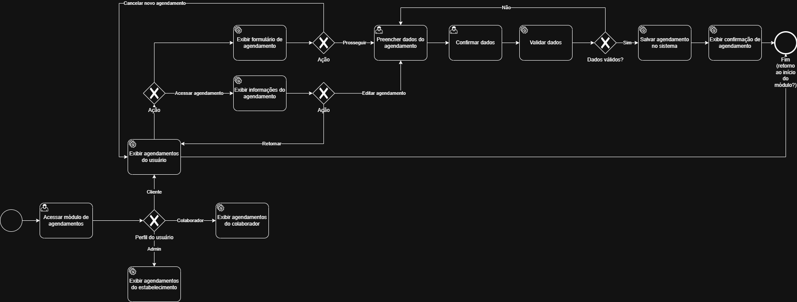

# 3.3.3 Processo 3 – GESTÃO DE AGENDAMENTO

O processo de **Gestão de Agendamento** tem como objetivo permitir que o usuário visualize agendamentos com base no seu perfil de acesso, permitindo que clientes e colaboradores se organizem para seus atendimentos e que o gestor possa ter uma visão global dos serviços sendo prestados.

Usuários definidos com perfil de **Cliente** podem ver e alterar os seus próprios agendamentos. Usuários com perfil de **Colaborador** podem ver e alterar os agendamentos em que são os responsáveis pelo serviço. Usuários com o perfil de **Admin** podem ver e alterar todos os agendamentos existentes.

## Oportunidades de melhoria

A informatização do processo de Gestão de Agendamento traz as seguintes oportunidades de melhoria:

- Previne que colaboradores agendem **serviços concomintantes**.
- Melhor **organização** para colaboradores.
- Melhora a **experiência do cliente**.
- Facilita a **gestão de recursos** do estabelicimento.

## Modelagem

Em seguida, apresenta-se o modelo do processo de Gestão de Agendamento, descritos no padrão BPMN:

### Detalhamento das atividades

_Descreva aqui cada uma das propriedades das atividades do processo 3. 
Devem estar relacionadas com o modelo de processo apresentado anteriormente._

_Os tipos de dados a serem utilizados são:_

_* **Área de texto** - campo texto de múltiplas linhas_

_* **Caixa de texto** - campo texto de uma linha_

_* **Número** - campo numérico_

_* **Data** - campo do tipo data (dd-mm-aaaa)_

_* **Hora** - campo do tipo hora (hh:mm:ss)_

_* **Data e Hora** - campo do tipo data e hora (dd-mm-aaaa, hh:mm:ss)_

_* **Imagem** - campo contendo uma imagem_

_* **Seleção única** - campo com várias opções de valores que são mutuamente exclusivas (tradicional radio button ou combobox)_

_* **Seleção múltipla** - campo com várias opções que podem ser selecionadas mutuamente (tradicional checkbox ou listbox)_

_* **Arquivo** - campo de upload de documento_

_* **Link** - campo que armazena uma URL_

_* **Tabela** - campo formado por uma matriz de valores_

**Exibir Agendamentos**

| **Campo**       | **Tipo**         | **Restrições** | **Valor default** |
| ---             | ---              | ---            | ---               |
| calendario | Data  |                |                   |
| agendamento | Hora |                |                |
| serviço | Caixa de Texto   |                |           |
| novoAgendamento | Link   |                |           |

| **Comandos**         |  **Destino**                   | **Tipo** |
| ---                  | ---                            | ---               |
| seletor de data | Atividade "Exibir Agendamento" em novas datas  |               |
| agendamento               | Atividade "Exibir Detalhes do Agendamento" |            |
| cadastrar            | Início do proceso de cadastro  |                   |

**Exibir Detalhes do Agendamento**

| **Campo**       | **Tipo**         | **Restrições** | **Valor default** |
| ---             | ---              | ---            | ---               |
| serviço | Caixa de Texto |                |                   |
| data | Data |                |                   |
| horario | Hora |                |                   |
| profissional | Caixa de Texto |                |                   |
| valor | Número |                |                   |

| **Comandos**         |  **Destino**                   | **Tipo**          |
| ---                  | ---                            | ---               |
| [Nome do botão/link] | Atividade/processo de destino  | (default/cancel/  ) |
|                      |                                |                   |

**Exibir Cancelamento de Agendamento**

**Exibir Formulário de Agendamento**

**Exibir Confirmação de Agendamento**

### Wireframes

Os wireframes abaixo estão agrupados por perfil de acesso (**administrador**, **prestador/colaborador** e **cliente**), na ordem sugerida da jornada na interface.

#### Visualização do administrador

**Lista de agendamentos**

")

**Busca e filtros**

")

**Criação de agendamento**

")

**Detalhes do agendamento**

")

**Edição do agendamento**

")

#### Visualização do prestador (colaborador)

**Lista de agendamentos**

")

**Busca e filtros**

")

**Detalhes do agendamento**

")

**Edição do agendamento**

")

**Exclusão / cancelamento**

")

#### Visualização do cliente

**Lista de agendamentos**

")

**Busca e filtros**

")

**Criação de agendamento**

")

**Detalhes do agendamento**

")

**Edição do agendamento**

")

**Exclusão / cancelamento**

")

