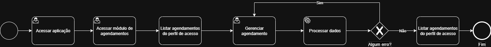

# 3.3.3 Processo 3 – GESTÃO DE AGENDAMENTO

O processo de **Gestão de Agendamento** permite que administradores, colaboradores e clientes visualizem e gerenciem agendamentos de serviços, cada um com visibilidade adequada ao seu perfil.

Ao acessar a funcionalidade, o usuário vê um calendário semanal com todos os agendamentos permitidos para seu perfil. A partir dessa tela principal, que chamamos de Gerenciar Agendamentos, ele pode navegar entre semanas, usar a busca para filtrar rapidamente, abrir os detalhes de um compromisso, criar um novo agendamento ou, com base no perfil, editar ou excluir um existente.

**O fluxo:**
- Ao selecionar um agendamento no calendário, o usuário aciona a atividade Gerenciar Agendamentos, onde vê todas as informações e pode optar por Editar ou Excluir.
- A opção Criar Agendamento abre um formulário em branco, enquanto Editar Agendamento reaproveita o mesmo formulário, já preenchido.
- A exclusão sempre passa por uma confirmação simples para evitar remoções acidentais.
- Em todas as etapas, é possível cancelar a ação e retornar ao calendário.

## Oportunidades de melhoria

A informatização do processo de Gestão de Agendamento traz as seguintes oportunidades de melhoria:

- Prevenção de conflitos: o sistema impede o cadastro de serviços concomitantes para o mesmo prestador ou recurso, algo impossível no controle manual.
- Organização e visibilidade: a visualização semanal unificada, com filtros e busca, dá a cada perfil exatamente a informação necessária no momento certo.
- Experiência do cliente: redução de retrabalhos e atrasos, com horários claros e lembretes automáticos (potencial).
- Gestão de recursos: o administrador consegue balancear a carga dos colaboradores e ajustar a oferta de serviços com dados reais de agendamento.

## Modelagem

### Detalhamento das atividades
 
#### Acessar a lista de agendamentos
 
| **Campo**               | **Tipo**  | **Restrições**  | **Valor padrão**                  |
| ----------------------- | --------- | --------------- | --------------------------------- |
| Calendário semanal      | Exibição  | somente leitura | semana atual                      |
| Agendamento (card)      | Exibição  | somente leitura | dados do agendamento preenchidos  |
 
| **Comandos**            | **Destino**                                      | **Tipo** |
| ----------------------- | ------------------------------------------------ | -------- |
| Semana anterior (<)     | Atividade "Acessar a lista de agendamentos"      | padrão   |
| Próxima semana (>)      | Atividade "Acessar a lista de agendamentos"      | padrão   |
| Clicar em agendamento   | Atividade "Visualizar detalhes do agendamento"   | padrão   |
| + Adicionar             | Atividade "Criar agendamento"                    | padrão   |
 
| **Resultado**           | **Destino**                                      |
| ----------------------- | ------------------------------------------------ |
| Semana alterada         | Calendário atualizado para a semana selecionada  |
| Agendamento selecionado | Atividade "Visualizar detalhes do agendamento"   |
| Novo agendamento        | Atividade "Criar agendamento"                    |

## Wireframes

**Lista de agendamentos**

")
 
---
 
#### Buscar e filtrar agendamentos
 
| **Campo**               | **Tipo**       | **Restrições** | **Valor padrão** |
| ----------------------- | -------------- | -------------- | ---------------- |
| Buscar agendamentos     | Caixa de texto | vazio          | vazio            |
 
| **Comandos**            | **Destino**                                         | **Tipo** |
| ----------------------- | --------------------------------------------------- | -------- |
| Digitar termo de busca  | Atividade "Buscar e filtrar agendamentos"            | padrão   |
| Editar (lápis)          | Atividade "Editar agendamento"                      | padrão   |
| Excluir (lixeira)       | Atividade "Excluir agendamento"                     | padrão   |
 
| **Resultado**           | **Destino**                                         |
| ----------------------- | --------------------------------------------------- |
| Agendamentos encontrados | Listagem filtrada pelo termo digitado              |
| Nenhum resultado        | Listagem vazia                                      |
| Busca apagada           | Retorno ao calendário semanal padrão                |

## Wireframes

**Busca e filtros**

")
 
---
 
#### Criar agendamento
 
| **Campo**               | **Tipo**       | **Restrições**             | **Valor padrão** |
| ----------------------- | -------------- | -------------------------- | ---------------- |
| Nome do serviço         | Caixa de texto | obrigatório                | vazio            |
| Cliente                 | Seleção única  | obrigatório                | vazio            |
| Prestador               | Seleção única  | obrigatório                | vazio            |
| Data                    | Data           | obrigatório; formato válido | vazio           |
| Horário de início       | Hora           | obrigatório; formato válido | vazio           |
| Duração                 | Caixa de texto | obrigatório                | 1 hora           |
| Valor                   | Numérico       | obrigatório; valor ≥ 0     | R$ 0,00          |
 
| **Comandos**  | **Destino**                                           | **Tipo** |
| ------------- | ----------------------------------------------------- | -------- |
| Adicionar     | Atividade "Acessar a lista de agendamentos"           | padrão   |
| Cancelar      | Atividade "Acessar a lista de agendamentos"           | cancelar |
 
| **Resultado**           | **Destino**                                           |
| ----------------------- | ----------------------------------------------------- |
| Agendamento criado      | Toast de sucesso e Atividade "Acessar a lista de agendamentos" |
| Prompt de erro          | "Campo inválido."                                     |
| Operação cancelada      | Atividade "Acessar a lista de agendamentos"           |

## Wireframes

**Criação de agendamento**

")
 
---
 
#### Visualizar detalhes do agendamento
 
| **Campo**               | **Tipo**  | **Restrições**  | **Valor padrão**                  |
| ----------------------- | --------- | --------------- | --------------------------------- |
| Serviço                 | Exibição  | somente leitura | dado do agendamento               |
| Cliente                 | Exibição  | somente leitura | dado do agendamento               |
| Prestador               | Exibição  | somente leitura | dado do agendamento               |
| Data                    | Exibição  | somente leitura | dado do agendamento               |
| Horário                 | Exibição  | somente leitura | dado do agendamento               |
| Duração                 | Exibição  | somente leitura | dado do agendamento               |
| Valor                   | Exibição  | somente leitura | dado do agendamento               |
| Status                  | Exibição  | somente leitura | dado do agendamento               |
 
| **Comandos**  | **Destino**                                           | **Tipo** |
| ------------- | ----------------------------------------------------- | -------- |
| Editar        | Atividade "Editar agendamento"                        | padrão   |
| Excluir       | Atividade "Excluir agendamento"                       | padrão   |
| X (fechar)    | Atividade "Acessar a lista de agendamentos"           | cancelar |
 
| **Resultado**           | **Destino**                                           |
| ----------------------- | ----------------------------------------------------- |
| Modal de edição aberto  | Atividade "Editar agendamento"                        |
| Modal de exclusão aberto | Atividade "Excluir agendamento"                      |
| Modal fechado           | Atividade "Acessar a lista de agendamentos"           |

## Wireframes

**Detalhes do agendamento**

")
 
---
 
#### Editar agendamento
 
| **Campo**               | **Tipo**       | **Restrições**             | **Valor padrão**        |
| ----------------------- | -------------- | -------------------------- | ----------------------- |
| Nome do serviço         | Caixa de texto | obrigatório                | atual preenchido        |
| Cliente                 | Caixa de texto | obrigatório                | atual preenchido        |
| Prestador               | Caixa de texto | obrigatório                | atual preenchido        |
| Data                    | Data           | obrigatório; formato válido | atual preenchido       |
| Horário de início       | Hora           | obrigatório; formato válido | atual preenchido       |
| Duração                 | Caixa de texto | obrigatório                | atual preenchido        |
| Valor                   | Numérico       | obrigatório; valor ≥ 0     | atual preenchido        |
 
| **Comandos**  | **Destino**                                           | **Tipo** |
| ------------- | ----------------------------------------------------- | -------- |
| Salvar        | Atividade "Acessar a lista de agendamentos"           | padrão   |
| Excluir       | Atividade "Excluir agendamento"                       | padrão   |
| Cancelar      | Atividade "Acessar a lista de agendamentos"           | cancelar |
| X (fechar)    | Atividade "Acessar a lista de agendamentos"           | cancelar |
 
| **Resultado**           | **Destino**                                           |
| ----------------------- | ----------------------------------------------------- |
| Agendamento alterado    | Toast de sucesso e Atividade "Acessar a lista de agendamentos" |
| Prompt de erro          | "Não foi possível salvar alteração. Tente novamente." |
| Operação cancelada      | Atividade "Acessar a lista de agendamentos"           |

## Wireframes

**Edição do agendamento**

")
 
---

#### Excluir / cancelar agendamento
 
| **Campo**               | **Tipo**  | **Restrições**  | **Valor padrão**             |
| ----------------------- | --------- | --------------- | ---------------------------- |
| Prompt de confirmação   | Exibição  | somente leitura | mensagem de confirmação      |
 
| **Comandos**  | **Destino**                                           | **Tipo** |
| ------------- | ----------------------------------------------------- | -------- |
| Excluir       | Atividade "Acessar a lista de agendamentos"           | padrão   |
| Cancelar      | Atividade "Acessar a lista de agendamentos"           | cancelar |
| X (fechar)    | Atividade "Acessar a lista de agendamentos"           | cancelar |
 
| **Resultado**           | **Destino**                                           |
| ----------------------- | ----------------------------------------------------- |
| Agendamento excluído    | Toast de sucesso e Atividade "Acessar a lista de agendamentos" |
| Operação cancelada      | Atividade "Acessar a lista de agendamentos"           |

## Wireframes

**Exclusão / cancelamento**

")
