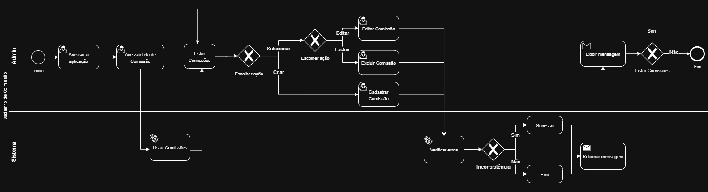
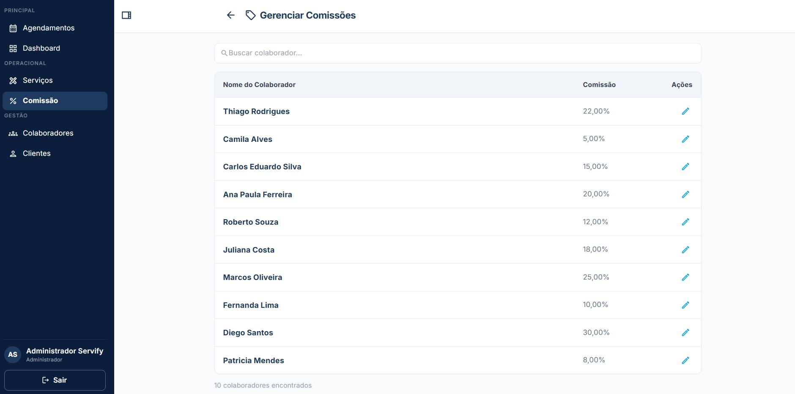
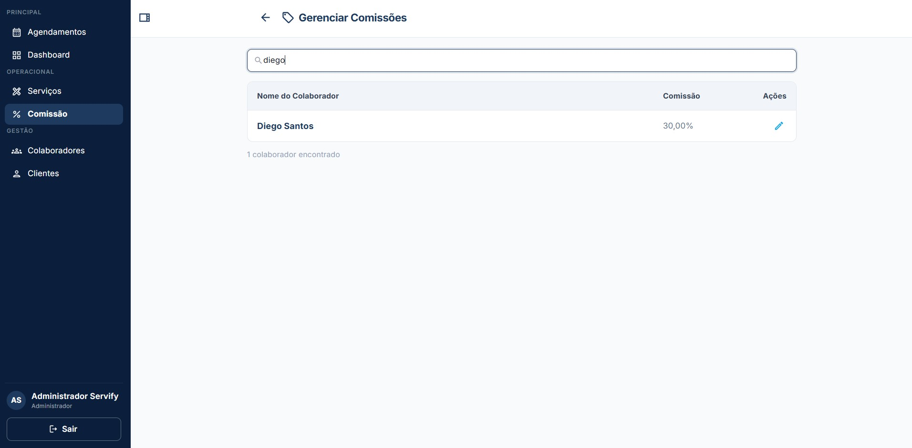
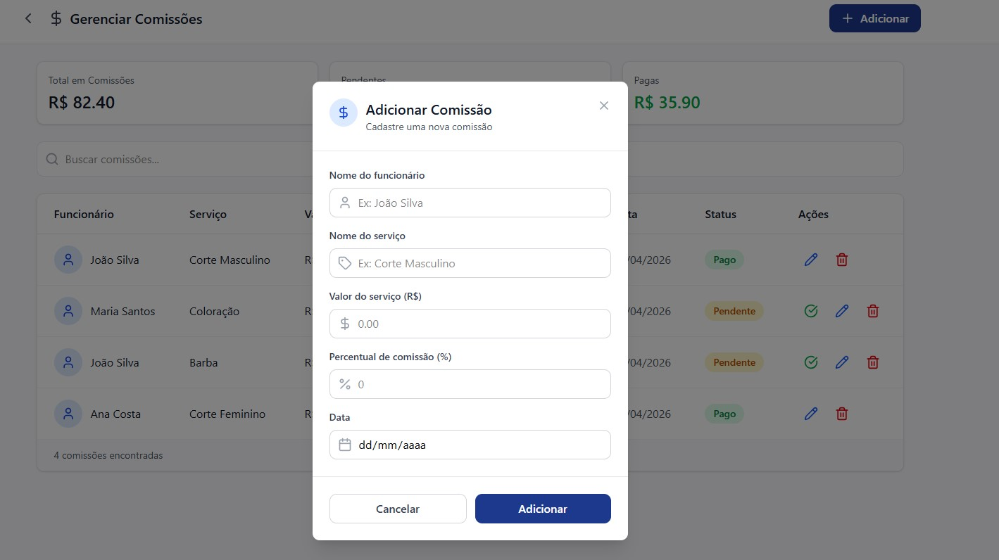
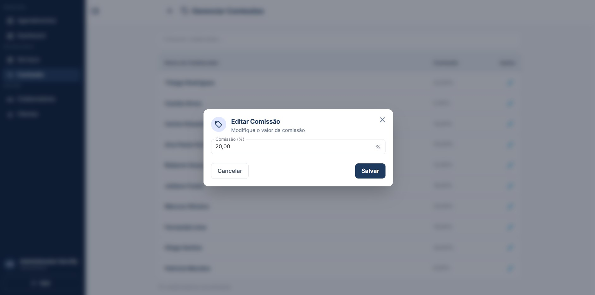
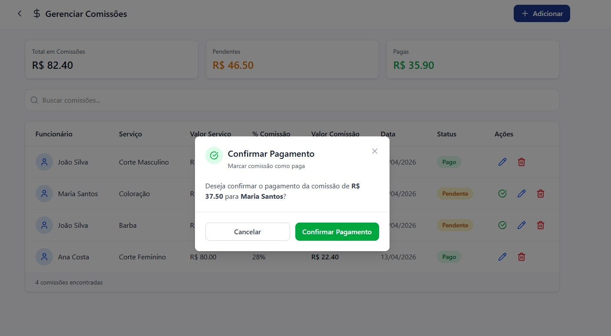
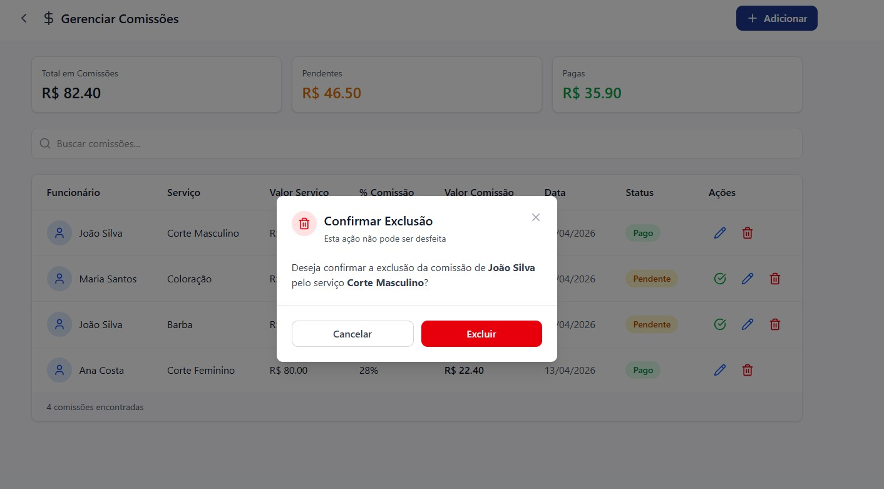

# 3.3.4 Processo 4 – GESTÃO DE COMISSÃO

O processo de **Gestão de Comissão** tem como objetivo permitir que o usuário visualize, cadastre, edite e exclua comissões dentro do sistema. Inicialmente, o sistema apresenta a listagem das comissões existentes, permitindo ao usuário visualizar os registros disponíveis. A partir dessa visualização, o usuário pode decidir realizar uma das ações disponíveis: cadastrar uma nova comissão, editar uma comissão existente ou excluir uma comissão.

Após a execução de qualquer uma dessas ações, o sistema retorna à listagem atualizada de comissões. O usuário pode repetir o ciclo de gerenciamento quantas vezes desejar até decidir finalizar o processo(ir para outra tela ou sair do software).

## Oportunidades de melhoria

A informatização do processo de Gestão de Comissão traz as seguintes oportunidades de melhoria:

• Implementação de **validações automáticas** para evitar cadastro de comissões duplicadas.

• Configuração de regras automáticas: cálculo automático de comissão (percentual por serviço e faixa de valor) reduzindo erros manuais.

• Inclusão de **confirmação antes da exclusão** de uma comissão.

• Possibilidade de **filtros e busca na listagem de comissões** para facilitar a navegação.

• Registro de **histórico de alterações** para auditoria.

• Feedback visual ao usuário após operações de cadastro, edição ou exclusão.

• Integração com dashboards financeiros e/ou relatórios.

## Modelagem

Em seguida, apresenta-se o modelo do processo de Gestão de Comissão, descrito no padrão BPMN:

O processo de **Gerenciamento de Comissões** tem como objetivo permitir que o administrador visualize, cadastre, edite, exclua e confirme o pagamento das comissões dos funcionários. O processo se inicia com o administrador acessando a página de Gerenciamento de Comissões, onde são exibidos três cards de resumo com os valores de total em comissões, comissões pendentes e comissões pagas, além de uma listagem de todas as comissões cadastradas com as colunas: funcionário, serviço, valor do serviço, percentual de comissão, valor da comissão, data, status e ações.
- Caso o administrador queira buscar uma comissão, ele digita um termo na barra de pesquisa e a listagem é filtrada de acordo com o nome do colaborador digitado, exibindo os resultados encontrados. O administrador pode apagar a digitação para retornar à listagem completa.
- Caso o administrador queira cadastrar uma nova comissão, ele pressiona o botão "+ Adicionar" e um modal é aberto com campos para preencher: nome do funcionário, nome do serviço, valor do serviço, percentual de comissão e data. Após preencher os campos, o administrador clica em "Adicionar" para confirmar o cadastro ou em "Cancelar" para fechar o modal sem salvar.
- Caso o administrador queira editar uma comissão, ele clica no ícone de lápis na linha correspondente e um modal é aberto com os campos preenchidos com os dados atuais da comissão: nome do funcionário, nome do serviço, valor do serviço, percentual de comissão e data. O campo "Valor da comissão" é exibido em modo somente leitura, calculado automaticamente a partir dos valores preenchidos. O administrador pode alterar os campos desejados e clicar em "Salvar" para confirmar as alterações ou em "Cancelar" para fechar o modal sem salvar.
- Caso o administrador queira confirmar o pagamento de uma comissão pendente, ele clica no ícone de confirmação (✓) na linha correspondente e um modal de confirmação é exibido informando o valor da comissão e o nome do funcionário. O administrador pode clicar em "Confirmar Pagamento" para marcar a comissão como paga ou em "Cancelar" para fechar o modal sem alterar o status.
- Caso o administrador queira excluir uma comissão, ele clica no ícone de lixeira na linha correspondente e um modal de confirmação é exibido informando o nome do funcionário e o serviço da comissão a ser excluída. O administrador pode clicar em "Excluir" para confirmar a exclusão ou em "Cancelar" para fechar o modal sem excluir.

### Detalhamento das atividades

#### Acessar a lista de comissões

| **Campo**           | **Tipo** | **Restrições**  | **Valor padrão**             |
| ------------------- | -------- | --------------- | ---------------------------- |
| Total em Comissões  | Exibição | somente leitura | valor calculado              |
| Pendentes           | Exibição | somente leitura | valor calculado              |
| Pagas               | Exibição | somente leitura | valor calculado              |
| Buscar comissões    | Caixa de texto | vazio     | vazio                        |
| Funcionário         | Exibição | somente leitura | dado da comissão             |
| Serviço             | Exibição | somente leitura | dado da comissão             |
| Valor Serviço       | Exibição | somente leitura | dado da comissão             |
| % Comissão          | Exibição | somente leitura | dado da comissão             |
| Valor Comissão      | Exibição | somente leitura | dado da comissão             |
| Data                | Exibição | somente leitura | dado da comissão             |
| Status              | Exibição | somente leitura | dado da comissão             |

| **Comandos**              | **Destino**                                      | **Tipo** |
| ------------------------- | ------------------------------------------------ | -------- |
| + Adicionar               | Atividade "Cadastrar comissão"                   | padrão   |
| Confirmar pagamento (✓)   | Atividade "Confirmar pagamento"                  | padrão   |
| Editar (lápis)            | Atividade "Editar comissão"                      | padrão   |
| Excluir (lixeira)         | Atividade "Excluir comissão"                     | padrão   |

| **Resultado**             | **Destino**                                      |
| ------------------------- | ------------------------------------------------ |
| Comissão encontrada       | Listagem filtrada pelo termo digitado            |
| Nenhum resultado          | Listagem vazia                                   |
| Busca apagada             | Retorno à listagem completa                      |
| Modal de cadastro aberto  | Atividade "Cadastrar comissão"                   |
| Modal de edição aberto    | Atividade "Editar comissão"                      |
| Modal de pagamento aberto | Atividade "Confirmar pagamento"                  |
| Modal de exclusão aberto  | Atividade "Excluir comissão"                     |

---

#### Cadastrar comissão

| **Campo**                   | **Tipo**       | **Restrições**              | **Valor padrão** |
| --------------------------- | -------------- | --------------------------- | ---------------- |
| Nome do funcionário         | Caixa de texto | obrigatório                 | vazio            |
| Nome do serviço             | Caixa de texto | obrigatório                 | vazio            |
| Valor do serviço (R$)       | Numérico       | obrigatório; valor ≥ 0      | 0,00             |
| Percentual de comissão (%)  | Numérico       | obrigatório; valor entre 0 e 100 | 0           |
| Data                        | Data           | obrigatório; formato válido | vazio            |

| **Comandos** | **Destino**                                           | **Tipo** |
| ------------ | ----------------------------------------------------- | -------- |
| Adicionar    | Atividade "Acessar a lista de comissões"              | padrão   |
| Cancelar     | Atividade "Acessar a lista de comissões"              | cancelar |
| X (fechar)   | Atividade "Acessar a lista de comissões"              | cancelar |

| **Resultado**          | **Destino**                                                        |
| ---------------------- | ------------------------------------------------------------------ |
| Comissão cadastrada    | Toast de sucesso e Atividade "Acessar a lista de comissões"        |
| Prompt de erro         | "Campo inválido."                                                  |
| Operação cancelada     | Atividade "Acessar a lista de comissões"                           |

---

#### Editar comissão

| **Campo**                   | **Tipo**       | **Restrições**              | **Valor padrão**   |
| --------------------------- | -------------- | --------------------------- | ------------------ |
| Nome do funcionário         | Caixa de texto | obrigatório                 | atual preenchido   |
| Nome do serviço             | Caixa de texto | obrigatório                 | atual preenchido   |
| Valor do serviço (R$)       | Numérico       | obrigatório; valor ≥ 0      | atual preenchido   |
| Percentual de comissão (%)  | Numérico       | obrigatório; valor entre 0 e 100 | atual preenchido |
| Data                        | Data           | obrigatório; formato válido | atual preenchido   |
| Valor da comissão           | Exibição       | somente leitura; calculado  | atual calculado    |

| **Comandos** | **Destino**                                           | **Tipo** |
| ------------ | ----------------------------------------------------- | -------- |
| Salvar       | Atividade "Acessar a lista de comissões"              | padrão   |
| Cancelar     | Atividade "Acessar a lista de comissões"              | cancelar |
| X (fechar)   | Atividade "Acessar a lista de comissões"              | cancelar |

| **Resultado**          | **Destino**                                                        |
| ---------------------- | ------------------------------------------------------------------ |
| Comissão alterada      | Toast de sucesso e Atividade "Acessar a lista de comissões"        |
| Prompt de erro         | "Não foi possível salvar alteração. Tente novamente."              |
| Operação cancelada     | Atividade "Acessar a lista de comissões"                           |

---

#### Confirmar pagamento

| **Campo**                | **Tipo**  | **Restrições**  | **Valor padrão**        |
| ------------------------ | --------- | --------------- | ----------------------- |
| Prompt de confirmação    | Exibição  | somente leitura | mensagem de confirmação |

| **Comandos**          | **Destino**                                           | **Tipo** |
| --------------------- | ----------------------------------------------------- | -------- |
| Confirmar Pagamento   | Atividade "Acessar a lista de comissões"              | padrão   |
| Cancelar              | Atividade "Acessar a lista de comissões"              | cancelar |
| X (fechar)            | Atividade "Acessar a lista de comissões"              | cancelar |

| **Resultado**          | **Destino**                                                        |
| ---------------------- | ------------------------------------------------------------------ |
| Pagamento confirmado   | Toast de sucesso e Atividade "Acessar a lista de comissões"        |
| Operação cancelada     | Atividade "Acessar a lista de comissões"                           |

---

#### Excluir comissão

| **Campo**                | **Tipo**  | **Restrições**  | **Valor padrão**        |
| ------------------------ | --------- | --------------- | ----------------------- |
| Prompt de confirmação    | Exibição  | somente leitura | mensagem de confirmação |

| **Comandos** | **Destino**                                           | **Tipo** |
| ------------ | ----------------------------------------------------- | -------- |
| Excluir      | Atividade "Acessar a lista de comissões"              | padrão   |
| Cancelar     | Atividade "Acessar a lista de comissões"              | cancelar |
| X (fechar)   | Atividade "Acessar a lista de comissões"              | cancelar |

| **Resultado**          | **Destino**                                                        |
| ---------------------- | ------------------------------------------------------------------ |
| Comissão excluída      | Toast de sucesso e Atividade "Acessar a lista de comissões"        |
| Operação cancelada     | Atividade "Acessar a lista de comissões"                           |

## Wireframes

#### Acessar a lista de comissões

#### Buscar comissão

#### Cadastrar comissão

#### Editar comissão

#### Confirmar pagamento

#### Excluir comissão

