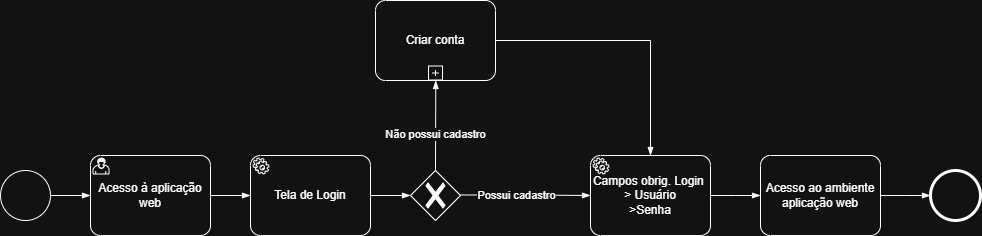

### 3.3.X Processo X – GESTÃO DE CLIENTES

[DEPRECIADO] -> Inserir as informações relevantes no Processo 1

O processo de **Gestão de Clientes** tem como objetivo permitir o acesso à aplicação aos usuários a nível de cliente do estabelecimento.
Para o cliente acessar é necessário cadastro, com a finalidade de identificar e utilizar desses dados para outras gestões do projeto.

#### Oportunidades de molhoria

* Centralização das informações cadastrais em um único sistema;
* Possibilidade de integração aos processos de agendamento e serviços;
* Maior segurança e confiabilidade às informações aramazenadas.

#### Detalhamento das atividades

**Tela de login**

| **Campo**       | **Tipo**         | **Restrições** | **Valor default** |
| ---             | ---              | ---            | ---               |
| Opções de acesso | Caixa de texto |                |                   |
| login           | Caixa de Texto   |  |                |
| senha           | Caixa de Texto   | |           |

| **Comandos**         |  **Destino**                   | **Tipo** |
| ---                  | ---                            | ---               |
| Acessar| direciona à aplicação  | (default/cancel  ) |
| criar conta      |  direciona à criação de conta                              |                   |

