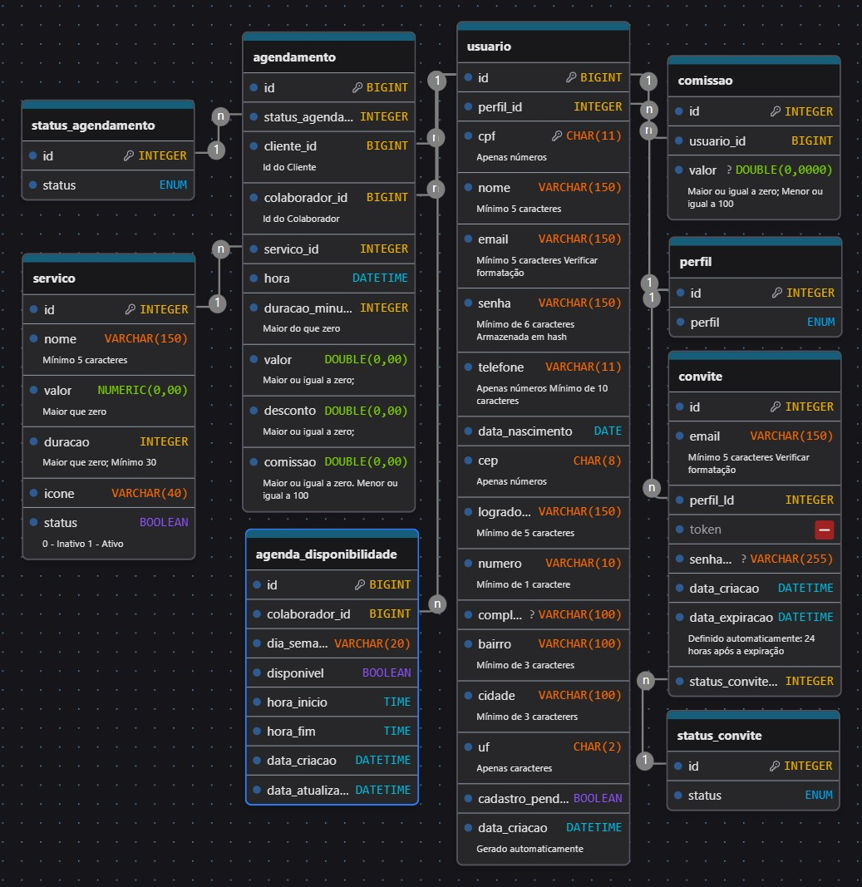

## 4. Projeto da solução

### 4.1. Modelo de dados

O modelo relacional Servify conta com 5 tabelas.
- A tabela **usuario** permite armazenar usuários e distinguir entre os diferentes perfis existentes na plataforma
- A tabela **endereco** permite armazenar endereços e que multiplos usuários compartilhem o mesmo endereço
- A tabela **comissao** permite armazenar o valor de comissão que um colaborador recebe por um serviço prestado
- A tabela **servico** permite armazenar diferentes serviços que o estabelecimente oferece
- A tabela **agendamento** permite armazenar um agendamento de um serviço e serve de base para o cálculo do valor faturado pelo estabelecimento e do valor de comissão devida ao colaborador que prestou o serviço

---

### 4.2. Tecnologias

_Descreva qual(is) tecnologias você vai usar para resolver o seu problema, ou seja, implementar a sua solução. Liste todas as tecnologias envolvidas, linguagens a serem utilizadas, serviços Web, frameworks, bibliotecas, IDEs de desenvolvimento, e ferramentas._

| **Dimensão**   | **Tecnologia**    |
| ---            | ---               |
| SGBD           | PostgreSQL        |
| Front end      | React HTML+CSS+JS |
| Back end       | Java SpringBoot   |
| Deploy         | Github Pages      |

